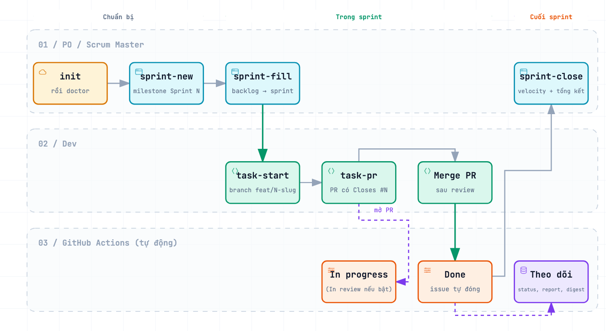

# tasks-manager

[](https://github.com/tuandtse243/tasks-manager/actions/workflows/ci.yml)

Chạy Scrum ngay trên GitHub, không cần Jira hay Trello. Repo này là một **marketplace plugin của
Claude Code**. Hiện marketplace có một plugin là [`scrum-github`](plugins/scrum-github/README.md).

| Scrum | Trên GitHub |
|---|---|
| Sprint | Milestone `Sprint {n}` |
| Task | Issue có label `status: …` và `points: N` |
| Trạng thái | Tự đổi khi mở hoặc merge PR có `Closes #n` |
| Lập kế hoạch | Claude chia yêu cầu thành epic → feature → task, bạn duyệt rồi mới tạo issue |
| Theo dõi | Bảng tiến độ có mục "Cần chú ý", báo cáo HTML có burndown, digest mỗi sáng (cả trên Slack/Telegram nếu muốn) |

## Cài trong ba bước

1. Công cụ: `brew install gh jq yq`, rồi `gh auth login -h github.com -s repo,workflow`.
2. Plugin, trong Claude Code:
   ```
   /plugin marketplace add tuandtse243/tasks-manager
   /plugin install scrum-github@tasks-manager
   ```
3. Trong repo dự án: `/scrum-github:init`, commit và push `.github/` lên nhánh mặc định, rồi
   `/scrum-github:doctor` để kiểm tra cả bộ.

## Một task từ đầu tới cuối

```
/scrum-github:sprint-new bắt đầu thứ 2 tới          # SM: tạo Sprint 1
/scrum-github:task-new Đăng nhập bằng email, 3 điểm  # PO: tạo task #12 trong sprint
/scrum-github:task-start 12                          # Dev: nhận task, sang In progress, tạo branch
git push -u origin feat/12-dang-nhap-bang-email      # Dev: code xong thì push
/scrum-github:task-pr                                # Dev: mô tả PR có "Closes #12", mở PR
                                                     # Merge PR: #12 tự sang Done và đóng
/scrum-github:sprint-status                          # Cả team: tiến độ và mục "Cần chú ý"
```

Không biết làm gì tiếp thì hỏi `/scrum-github:next`.



## Bạn là ai thì đọc gì

| Bạn là | Đọc |
|---|---|
| Product Owner | [Cheat sheet PO](docs/cheat-sheet-po.md) |
| Scrum Master | [Cheat sheet SM](docs/cheat-sheet-sm.md), rồi [Hướng dẫn áp dụng](docs/huong-dan-ap-dung.md) để thiết lập repo và quy ước team |
| Dev | [Cheat sheet Dev](docs/cheat-sheet-dev.md) |
| Cần tra mọi lệnh, tuỳ chọn, khoá cấu hình | [README của plugin](plugins/scrum-github/README.md) (tiếng Anh) |
| Người phát triển plugin | [Bối cảnh dự án](docs/project-context.md), [kiểm thử end-to-end](plugins/scrum-github/docs/e2e-testing.md), spec trong `openspec/specs/` |

## Cấu trúc repo

```
.claude-plugin/marketplace.json   khai báo marketplace "tasks-manager"
plugins/scrum-github/             mã nguồn plugin
  skills/                         các lệnh /scrum-github:*
  agents/                         agent chỉ đọc: codebase-scout, researcher, plan-critic
  runtime/                        CLI `scrum` (bash + jq), được chép vào repo dự án khi init
  templates/                      workflow, issue form, PR template cài vào repo dự án
  tests/                          test offline với `gh` giả
docs/                             hướng dẫn áp dụng, cheat sheet theo vai trò, bối cảnh dự án
  diagrams/                       sơ đồ flow (nguồn archify .json, bản .html tương tác, ảnh .png)
openspec/                         spec (specs/) và lịch sử thay đổi (changes/archive/)
```

## Phát triển

```bash
bash plugins/scrum-github/tests/run.sh          # toàn bộ test, offline, khoảng 2 phút
bash plugins/scrum-github/tests/run.sh plan     # chỉ chạy tests/test_plan.sh
```

Lint mã shell (không lint `vendor/`) và kiểm tra plugin:

```bash
(cd plugins/scrum-github && shellcheck --severity=warning bin/scrum runtime/bin/scrum runtime/lib/*.sh scripts/*.sh wizards/*.sh tests/run.sh tests/test_*.sh tests/fake-gh)
claude plugin validate plugins/scrum-github     # chạy tay, CI không cài Claude Code
```

CI (`.github/workflows/ci.yml`) chạy bộ test trên Ubuntu cùng lệnh `shellcheck` ở trên cho mỗi
pull request, và chạy thêm bộ test trên macOS mỗi lần push vào `main` (repo riêng tư tính phút macOS
gấp mười). Lịch sử phiên bản của plugin ở
[CHANGELOG](plugins/scrum-github/CHANGELOG.md).

Claude Code có thể tạo thư mục `openspec/changes/.claude/` khi ghi file dưới `openspec/changes/`.
Thư mục này đã nằm trong `.gitignore`, nhưng `openspec list` vẫn có thể hiện nó như một change tên
`.claude`; bỏ qua hoặc xoá đi.

Mỗi thay đổi lớn đi qua OpenSpec: đề xuất bằng `/opsx:propose`, làm bằng `/opsx:apply`, xong thì
`/opsx:archive` để gộp spec vào `openspec/specs/`.
