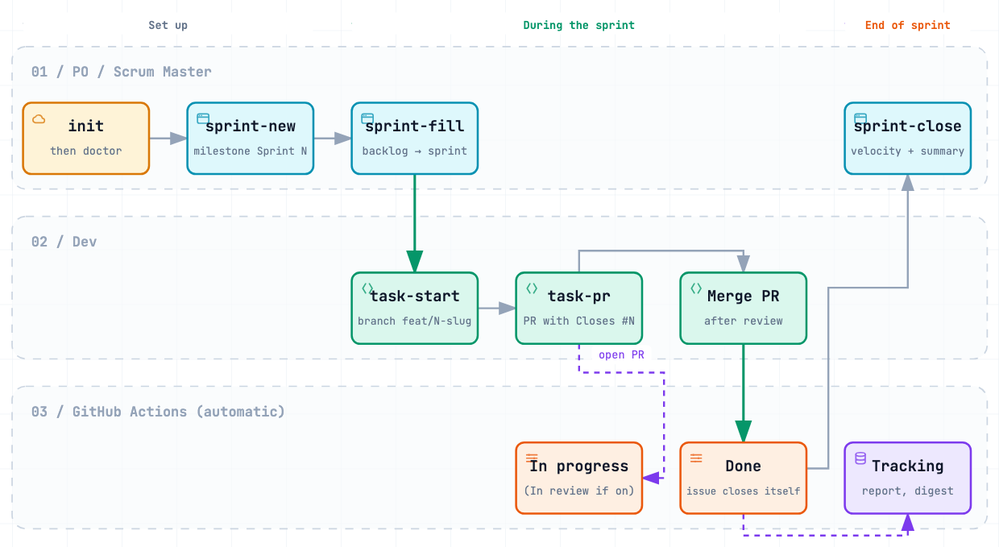
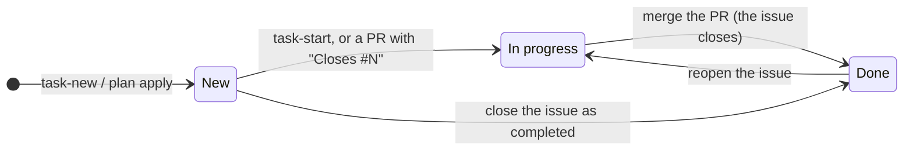
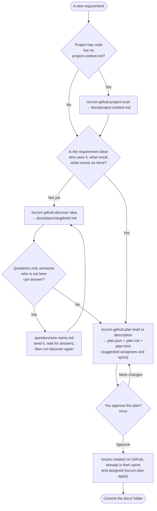
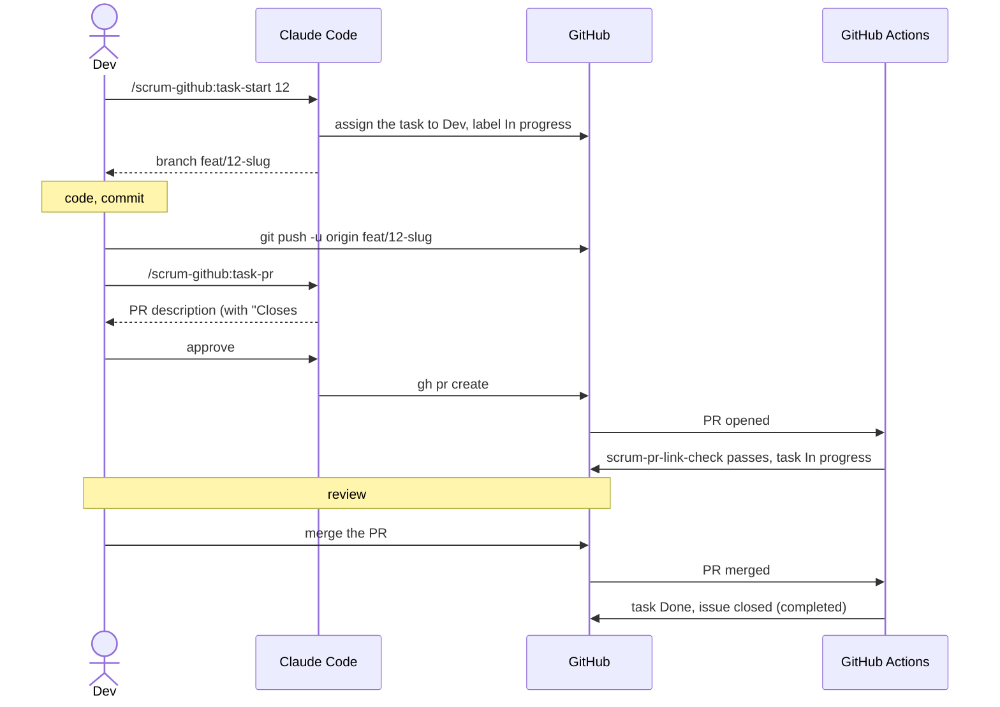
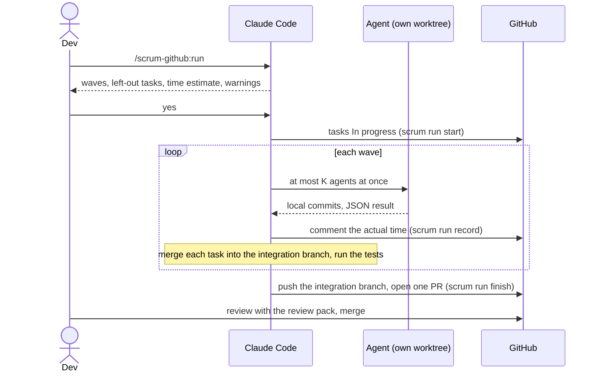

# scrum-github adoption guide

For the whole team: Product Owner, Scrum Master and Developers. New to it? Read sections 1 to 4.
Already using it? Look things up in the [command table](#2-commands) and the [flows](#5-flows).
The full reference of commands and configuration is the
[plugin README](../plugins/scrum-github/README.md).

**Contents**
1. [What the plugin does](#1-what-the-plugin-does)
2. [Commands](#2-commands)
3. [Install (once per person)](#3-install-once-per-person)
4. [Set up the project repository (one person, once)](#4-set-up-the-project-repository-one-person-once)
5. [Flows](#5-flows)
   - [Flow A: Open a new sprint](#flow-a-open-a-new-sprint)
   - [Flow B: From a requirement to tasks](#flow-b-from-a-requirement-to-tasks)
   - [Flow C: A developer works a task](#flow-c-a-developer-works-a-task)
   - [Flow D: Add a single task or a bug](#flow-d-add-a-single-task-or-a-bug)
   - [Flow E: Track progress](#flow-e-track-progress)
   - [Flow F: Close the sprint](#flow-f-close-the-sprint)
   - [Flow G: Let AI agents work tasks](#flow-g-let-ai-agents-work-tasks)
6. [Team conventions](#6-team-conventions)
7. [Kanban board (optional)](#7-kanban-board-optional)
8. [Troubleshooting](#8-troubleshooting)
9. [Current limits](#9-current-limits)
10. [Adoption checklist](#10-adoption-checklist)

---

## 1. What the plugin does

The plugin runs Scrum right on GitHub. It has no database of its own: **everything is a GitHub
issue, label or milestone**, so anyone with access to the repository can see the progress.



*Interactive version (zoom, search, trace paths): open [diagrams/sprint-flow.html](diagrams/sprint-flow.html)
locally. Source: [diagrams/sprint-flow.workflow.json](diagrams/sprint-flow.workflow.json).*

| Scrum | On GitHub | Good to know |
|---|---|---|
| Sprint | Milestone `Sprint {n}` | Start date, end date and velocity are stored hidden in the milestone description |
| Task | Issue | Has exactly one `status: …` label and at most one `points: N` label |
| Status | Labels `status: New`, `status: In progress`, `status: Done` | Changes on its own with pull requests. Do not edit by hand |
| Finished task | Issue **closed as "completed"** | Closed as "not planned" counts no points |
| Feature / Epic | Issue with the label `type: feature` / `type: epic`; its children are sub-issues | Counts no points |
| Backlog | Issue **without a milestone** | Not in sprint reports until it is put in a sprint |
| Plan | `docs/plans/<slug>/plan.json`, with the views `plan.md` and `plan.html` | A snapshot taken while planning. Once the issues exist, GitHub holds the real state |
| Velocity | Points of the Done tasks in a sprint | Recorded when the sprint is closed |
| Team | `team` in `.github/scrum.yml` (optional) | Who works on the repo, their areas, capacity and review hours |

The life of a task:



---

## 2. Commands

In Claude Code, type each command as `/scrum-github:<name>`, optionally followed by a request in
plain words. Without Claude Code, call the `scrum` script (third column). In Claude Code, `scrum`
is on the PATH when the plugin is installed for your user (the default of `/plugin install`);
installed for one project only (local scope) or loaded with `--plugin-dir`, it is not, and the
skills call it by its full path instead. Once set up, the project repository also has the script at
`.github/scrum/bin/scrum`.

| Claude Code command | Who, when | Script | Example |
|---|---|---|---|
| `init` | SM, once per repo; again after changing the configuration or updating the plugin | `scrum init [--dry-run] [--force-file PATH]` | `/scrum-github:init` |
| `doctor` | Anyone, after installing or when a command fails | `scrum doctor [--json]` | `/scrum-github:doctor` |
| `next` | Anyone who does not know what to do next | `scrum next [--json]` | `/scrum-github:next` |
| `sprint-new` | SM, start of the sprint | `scrum sprint new [--start DATE] [--length DAYS] [--goal TEXT]` | `/scrum-github:sprint-new starting next Monday, goal "Sign up and log in"` |
| `sprint-fill` | SM and team, at Sprint Planning | `scrum sprint fill [SPRINT] [--capacity N] [--add N,N] [--yes]` | `/scrum-github:sprint-fill capacity 20 points` |
| (none) | SM, PO: see the team, their areas, capacity and load in the sprint | `scrum team [--json]` | `scrum team` |
| `backlog` | PO, SM: see work not yet in a sprint | `scrum backlog` | `/scrum-github:backlog which tasks have no estimate?` |
| `project-scan` | Tech lead, once for a project with existing code; again when the code changed a lot | `scrum context status` | `/scrum-github:project-scan` |
| `discover` | PO, when a requirement is still vague | (none) | `/scrum-github:discover let users comment under posts` |
| `plan` | PO, SM: turn a requirement into tasks | `scrum plan check FILE`, `scrum plan apply FILE` | `/scrum-github:plan docs/plans/blog-comments/brief.md` |
| `task-new` | Anyone: add one task or bug (to the open sprint, or the backlog when no sprint is open) | `scrum task new --title T [--points N] [--assignee LOGIN] [--sprint S \| --backlog] [--bug] [--work D] [--review D] [--by ai\|human]` | `/scrum-github:task-new bug: the Save button does nothing in Safari, 2 points, assign to an-nguyen` |
| `my-tasks` | Dev: see all your work and what to do next | `scrum mine [--user LOGIN]` | `/scrum-github:my-tasks` |
| `task-start` | Dev: pick up a task | `scrum task start N` | `/scrum-github:task-start 12` |
| `run` | Dev: let AI agents work your `ai-ready` tasks in parallel, into one pull request to review | `scrum run plan\|start\|record\|merge\|finish\|status` | `/scrum-github:run --dry-run`, `/scrum-github:run 102,107` |
| `task` | Anyone: list tasks, move them between sprints, change points or time, assign, drop | `scrum task list\|move\|estimate\|assign\|drop` | `/scrum-github:task change #12 to 3 points`, `scrum task estimate 12 --review 30m` |
| `task-pr` | Dev: write the PR description and open the PR | (uses `gh pr create`) | `/scrum-github:task-pr` |
| `sprint-status` | Whole team, daily | `scrum status [SPRINT]` | `/scrum-github:sprint-status who has the most work left?` |
| `sprint-report` | SM, for the review or for stakeholders | `scrum report [SPRINT] [--out FILE]` | `/scrum-github:sprint-report` |
| `sprint-close` | SM, end of the sprint | `scrum sprint close [SPRINT] [--yes] [--create-next]` | `/scrum-github:sprint-close` |
| `release` | SM or tech lead, after closing a sprint: publish a version (tag and GitHub Release) | `scrum release [VERSION] [--sprint S] [--since TAG] [--draft] [--notes-file FILE] [--yes]` | `/scrum-github:release --sprint "Sprint 5"` |
| `project-setup` | SM, once: turn on the kanban board (optional) | `bash wizards/project-board.sh`, `scrum project init` | `/scrum-github:project-setup` |
| (none) | SM, when the repo stops using the plugin | `scrum uninstall [--dry-run] [--yes]` | `scrum uninstall`, check, then add `--yes` |
| `protect` | Tech lead with admin rights, once after `init` and again after changing the preset: create `develop` (and `staging`), branch and tag rules, merge settings | `scrum protect [--json] [--yes]` | `/scrum-github:protect` |
| `sync` | Dev: bring the latest working branch into your task branch; conflicts are listed, never resolved | `scrum sync` | `/scrum-github:sync` |
| `branches` | Tech lead, SM: what waits on `develop`, drift from `main`, stale branches | `scrum branches [--json]` | `/scrum-github:branches what is not released yet?` |
| `cleanup` | Dev, tech lead: delete merged branches locally and on origin, after confirming | `scrum cleanup [--json] [--yes]` | `/scrum-github:cleanup` |

Every command that writes to GitHub shows you what it will do and asks first.

---

## 3. Install (once per person)

**Step 1. Install the tools.**

```bash
brew install gh jq yq
gh auth login -h github.com -s repo,workflow
```

**Step 2. Check them.**

```bash
gh auth status          # Logged in to github.com
jq --version            # jq-1.6 or later
yq --version            # must say "mikefarah"
```

> Do not use `pip install yq`: it installs a different tool with the same name, and the plugin
> rejects it.

**Step 3. Install the plugin in Claude Code** (skip this step if you do not use Claude Code):

```
/plugin marketplace add tuandtse243/tasks-manager
/plugin install scrum-github@tasks-manager
```

---

## 4. Set up the project repository (one person, once)

Usually the Scrum Master or the tech lead, in a clone of the project repository.

**Step 1. Initialize.** Open Claude Code at the root of the project repository:

```
/scrum-github:init
```

It shows a preview before writing anything. It creates:

| Created | What for |
|---|---|
| `.github/scrum.yml` | Configuration |
| Labels for status, points, `type: feature`, `type: epic`, `scrum: meta`, `no-task`, `ai-ready` | Existing labels are never deleted |
| `.github/ISSUE_TEMPLATE/task.yml` | A form to create a task on GitHub, with a Points field |
| `.github/pull_request_template.md` | Already has a `Closes #` line and the Evidence and Merge Danger sections |
| Workflows `scrum-status-sync`, `scrum-pr-link-check`, `scrum-daily-digest` | Change statuses, check that a PR links a task, post the digest |
| `.github/scrum/` | The runtime the workflows call, and `files.json`, the record of the files `init` wrote. Do not edit by hand |

**Step 2. Edit the configuration** in `.github/scrum.yml`. Keys you leave out take their default.
A suggested configuration for a team in Vietnam:

```yaml
version: 1
timezone: Asia/Ho_Chi_Minh        # "today", the burndown and the digest follow Vietnam time
language: vi                      # status table, digest, HTML report and sprint summary in Vietnamese (en is the default)
sprint:
  length_days: 12                 # calendar days, counting the first: Monday of week 1 to Friday of week 2
  working_days: [1, 2, 3, 4, 5]   # working days (1 = Monday); Monday to Friday is already the default
points:
  scale: [1, 2, 3, 5, 8]          # Fibonacci; split a task bigger than 8
digest:
  cron: "0 1 * * 1-5"             # UTC: 8 a.m. Vietnam time, Monday to Friday
  webhook_format: slack           # also send the digest to a chat: slack (also Google Chat, Mattermost) or telegram
attention:
  stale_days: 2                   # a task In progress with no activity for over 2 working days "needs attention"
  behind_percent: 15              # a sprint behind the ideal line by more than 15% of its scope "needs attention"
planning:
  hours_per_point: 4              # optional: plan.md also shows hours (1 point = 4 hours)
  merge_minutes: 5                # minutes to merge and run the tests between two waves, in time estimates (default 5)
team:                             # optional: /plan suggests assignees from this list
  - login: tuandt
    areas: [backend]              # what they usually work on
    capacity: 10                  # points per sprint
    review_hours: 6               # optional: hours of review per sprint; sprint-fill warns when exceeded
  - login: an-nguyen
    areas: [frontend]
```

Without `team`, the team is the people who can be assigned issues in the repository (taken from
GitHub, with no areas and no capacity). With `team`, `task new`, `task assign` and `plan check`
warn when you assign a login that is not on the list (the assignment still happens). Each person's
load: `scrum team`.

Check the configuration without any network call: `scrum config`. When you are done, run
`/scrum-github:init` again: it syncs the labels and updates the generated files to the new
configuration (the Issue Form when `points.scale` changes, the digest workflow when `digest.cron`
changes). Then commit and push.

**Step 3. Commit and push `.github/` to the default branch.** The workflows do not run until it is
pushed.

```bash
git add .github && git commit -m "Set up scrum-github" && git push
```

**Step 4. Turn on branch protection** for the main branch and require the `scrum-pr-link-check`
check to pass. Then nobody can merge a PR that links no task. Leave *Settings → Actions →
Workflow permissions* at its default.

**Step 5. Check everything** with `/scrum-github:doctor`: tools, login, configuration, labels, and
whether the workflows are on the default branch. Each problem comes with its fix. Then
`/scrum-github:next` tells you what to do next.

Running `init` again is always safe: a file that did not change reports `unchanged`; a file you
never edited that is out of date with the configuration or the plugin reports `updated` and is
updated; a file you edited by hand reports `conflict` and is kept. To take the new version of that
file, use `--force-file <path>`.

**Updating from 0.4 or earlier:** the `scrum-init` command is now `/scrum-github:init` (the old
name was removed in 0.6.0). On the first run after updating, the repository has no record of its
files yet, so every file that differs from the new version reports `conflict`; from the next run on,
files nobody edited update on their own.

**(Optional) The In review status.** To see which tasks are waiting for review, add this to
`.github/scrum.yml`:

```yaml
statuses:
  in_review: In review
```

then run `/scrum-github:init` again (it creates the label `status: In review` and updates the
workflows), commit and push. From then on, a draft PR keeps its task In progress, a PR ready for
review moves the task to In review, a PR turned back into a draft or closed without merging moves
the task back to In progress, and a merge makes it Done. The status table, digest and report get an
In review column; "Needs attention" lists tasks waiting for review for more than
`attention.review_days` working days. Turned on mid-sprint, existing tasks only change at their next
PR event. With the board, add an `In Review` column (a new option of the Status field, between In
Progress and Done) and run `scrum project init`; without that column the command stops and says so.
Remove the key to turn it off; the existing labels are kept. This flow was tried on a real repository
and board: draft PR, ready for review, back to draft, closed without merging, reopened and merged all
changed both the label and the board column correctly.

A repository set up before 0.5.0 that runs `init` again sees the workflows whose template changed
reported as `conflict`, even though nobody edited them: the old version did not record which files
`init` wrote. Compare each with the template, and for the ones you never edited add
`--force-file <path>` to take the new version.

**Removing it from a repository:** `scrum uninstall` shows what it will delete and what it will
keep; add `--yes` to delete. It keeps `.github/scrum.yml`, files you edited, and everything on
GitHub (labels, milestones, issues).

---

## 5. Flows

| When | Who | Flow |
|---|---|---|
| Start of the sprint | SM | [A. Open a new sprint](#flow-a-open-a-new-sprint) |
| Start of the sprint, or when a new requirement comes in | PO, SM | [B. From a requirement to tasks](#flow-b-from-a-requirement-to-tasks) |
| Daily | Dev | [C. A developer works a task](#flow-c-a-developer-works-a-task) |
| Any time | Whole team | [D. Add a single task or a bug](#flow-d-add-a-single-task-or-a-bug) |
| Daily | Whole team | [E. Track progress](#flow-e-track-progress) |
| End of the sprint | SM | [F. Close the sprint](#flow-f-close-the-sprint) |
| When you have `ai-ready` tasks | Dev | [G. Let AI agents work tasks](#flow-g-let-ai-agents-work-tasks) |
| After closing a sprint, or whenever you ship | SM, tech lead | [H. Release a version](#flow-h-release-a-version) |

### Flow A: Open a new sprint

```
/scrum-github:sprint-new starting next Monday, goal "Sign up and log in"
```

Or with the CLI:

```bash
scrum sprint new --start 2026-11-23 --goal "Sign up and log in"
```

- The name counts up following `Sprint {n}`; the length comes from `sprint.length_days` unless you
  pass `--length`.
- Claude turns relative dates ("next Monday") into a real date.
- The command warns when the dates overlap a sprint that is still open.

When the backlog already has tasks, the command reminds you that the next step is to choose tasks
for the sprint:

```
/scrum-github:sprint-fill
```

- The capacity defaults to the average velocity of up to the last three closed sprints; with no
  closed sprint yet, Claude asks you for a number (`--capacity N`).
- Claude proposes tasks that fit the capacity, blocking tasks before the tasks they block; you edit
  the list and look at the warnings (over capacity, tasks without points, tasks blocked by a task
  outside the sprint, a person over their `review_hours`) before you agree to move the tasks into
  the sprint.
- When tasks have time estimates, the command prints each person's total review minutes in the
  sprint (now and after adding), against their `review_hours`. The warning never stops tasks from
  being added.
- To see the backlog on its own: `/scrum-github:backlog`.

Next: [Flow B](#flow-b-from-a-requirement-to-tasks) or [Flow D](#flow-d-add-a-single-task-or-a-bug).

### Flow B: From a requirement to tasks

All you need to remember is `/scrum-github:plan`. When the requirement is still vague, it suggests
running `discover` first; when the project has code but no context document, it suggests
`project-scan`.



**No command writes to GitHub before you approve the plan.** You commit the files in `docs/`
yourself.

#### B1. Scan the project: `/scrum-github:project-scan`

Only needed for a project that already has code. The command reads the code and writes
`docs/project-context.md`: technology, structure, main flows, data model, conventions, how to run
and test, and a glossary. Every statement names the file it comes from; what the code does not say
is written as "unknown".

- Later runs only re-read the folders that changed. `--full` rescans everything.
- The "Team notes" section is written by the team and never overwritten.
- How out of date the document is: `scrum context status`.

#### B2. Clarify the requirement: `/scrum-github:discover <idea>`

Use it when the idea is still vague, for example:

```
/scrum-github:discover let users comment under posts
/scrum-github:discover docs/requirements/payments.md --deep
```

How a session goes:
1. Claude finds the facts itself (reads the code, searches the web) and **only asks you for
   decisions**.
2. Questions come in rounds, numbered, each with a suggested answer. Answer "yes" to accept every
   suggestion, or answer by number, for example `2: only logged-in users`.
3. It keeps asking until eight areas are covered: users and roles, main flow, data, edge cases,
   non-functional requirements, integrations, constraints, and what is out of scope.
4. For a project with code, it concludes whether the requirement *fits*, *fits with changes*, or
   *conflicts*. On a conflict, you choose an option before going on.
5. It keeps the terms in line with the project glossary: a word used with a different meaning
   becomes a question.
6. You confirm the summary, and the command writes `docs/plans/<slug>/brief.md`.

**Questions for someone who is not there.** When a decision belongs to someone who is not in the
session (the PO, a client), the command offers to write `questionnaire-<person>.md` next to the
brief. The brief is then `Status: draft` with an "Open questions" section. Send the file to that
person, they write their answers right under each question; then run `discover` again on the same
folder to finish the brief.

Three levels: `--quick` (at most one round of questions, no agents), the default, and `--deep`
(adds web research and an independent review of the brief).

#### B3. Plan: `/scrum-github:plan <brief or description>`

```
/scrum-github:plan docs/plans/blog-comments/brief.md
/scrum-github:plan add a CSV export button on the report page, for admins, done when the file downloads with the right columns --quick
```

How it goes:
1. It splits the requirement into tasks as **vertical slices**: each task delivers a behavior you
   can check on its own, not a technical layer standing alone. Each task has acceptance criteria,
   points from the scale, a time estimate (minutes of work, minutes for a person to review and test
   by hand, and whether AI or a person does it), subtasks (a checklist in the issue) and
   dependencies.
2. An agent reviews the draft: missing work, out of scope, tasks too large, wrong dependencies,
   acceptance criteria that cannot be checked. `--quick` skips this step.
3. It suggests an assignee for each task that has none (by `team.areas` and current load, only
   people in the team, keeping anyone you named) and a sprint (tasks that fit the open sprint's
   capacity, in dependency order, go into it; the rest go to the backlog, with the reason).
4. You review it **once**, in the chat and in the `plan.html` page next to `plan.md`: the task table
   with assignees and sprint, each person's load, the sprint's capacity, the findings, and the list
   of what will happen on GitHub. Ask for changes in plain words ("merge T3 with T4", "T6 into
   Sprint 5", "give T3 to @minh-ho") until you approve; the page is generated again and its
   "Changes" section shows what changed.
5. Once you approve, the command creates the epic, features and tasks on GitHub, already with their
   milestone and assignees, links sub-issues and dependencies, and writes the issue numbers into
   `plan.json`. No need to run `sprint-fill` or assign tasks afterwards.

**The `plan.html` page.** Written by `plan check`, `plan render` and `plan apply`; it opens without a
network and follows the light or dark mode of your machine. It has a summary, the changes since you
last looked, a dependency graph by waves (hover to see a chain of dependencies), a to-scale
timeline (when tasks have time estimates), load and capacity, each task in detail, the plan-critic's
findings, what will be created on GitHub, assumptions and what is out of scope. The page is only for
reading; you answer in the chat. `plan.html` and `.plan-snapshot.json` do not need to be committed
(`plan init` writes a `.gitignore` in the plan folder for them).

A plan built from a draft brief with open questions only goes on when you agree to turn each question
into an assumption.

**Sprint or backlog.** The command suggests a sprint for each task as above. A task with no `sprint`
goes to the **backlog** (no milestone, not in sprint reports). Write `"sprint": "current"` for the
open sprint, or a sprint's name; each task can have its own. To move a task from the backlog into a
sprint: set its milestone on GitHub, or edit `sprint` in the plan and run
`scrum plan apply <file> --update`.

**Estimates.** `plan.md` shows the points per feature and for the whole plan, how many tasks have no
points, hours (when `hours_per_point` is set), and the expected number of sprints from the average
velocity of up to the last three closed sprints.

**Time estimates.** Points measure complexity; time says when it is done. Each task can have an
`estimate`: `work_minutes` (how long the work takes), `review_minutes` (a person reviewing and
testing by hand, often the bottleneck when AI does the work) and `by` (`ai` or `human`). The plugin
keeps them in a block at the end of the issue body ("AI ~25m · Review ~20m"), not in labels.
`plan.md` and `plan.html` add up time **by waves**: the tasks of a wave run in parallel, so a wave
takes as long as its longest task, plus `planning.merge_minutes` (default 5) to merge and run the
tests; review time is the sum. For example, three waves (20m, 8m), (15m, 35m), (20m) finish their
work in 20 + 5 + 35 + 5 + 20 + 5 = 90 minutes. Tasks without an estimate are listed separately.

**Safe to run again.** `scrum plan apply` writes each issue number into `plan.json` right after the
issue is created:

| Situation | Command | Result |
|---|---|---|
| Preview | `scrum plan apply <file> --dry-run` | Prints what would be created, linked and skipped; writes nothing |
| The last run failed halfway | `scrum plan apply <file>` | Creates only what has no issue number yet |
| You just added tasks to the plan | `scrum plan apply <file>` | Creates only the new tasks and links them |
| You changed titles, bodies, points, time, sprint | `scrum plan apply <file> --update` | Updates open issues; does not touch status labels, assignees or closed issues |
| Continue an existing plan with Claude | `/scrum-github:plan docs/plans/<slug>/` | Keeps the existing ids and issue numbers |

> **Do not delete an `issue` number or change an `id` in the plan**: the next run would create
> duplicate issues.

### Flow C: A developer works a task



**Step 1. Pick up the task.** Not sure which? `/scrum-github:my-tasks` lists all your open tasks
(every sprint and the backlog), what blocks them, their time estimates, PRs waiting for your review,
and the task to do next.

```
/scrum-github:task-start 12
```

The command assigns the task to you (if nobody has it), sets it to In progress and creates the
branch `feat/12-<slug>` from the default branch. With uncommitted changes, git refuses to switch
branches, and nothing changes on GitHub.

**Step 2. Code, commit, push.** Push the branch before opening the PR:

```bash
git push -u origin feat/12-<slug>
```

**Step 3. Open the PR.**

```
/scrum-github:task-pr
```

- The command takes the task number from the branch name (`feat/12-…` is task 12) and reads the diff
  and the task's acceptance criteria.
- It writes a description with a summary of the change, **Evidence** (commands and tests run and
  their results, which criteria are proven), **Merge Danger** (risks of merging), and a **Task**
  section with the line `Closes #12`.
- You approve or ask for changes; only after you approve does it run `gh pr create`. When the PR is
  already open, it replaces the description with `gh pr edit`.

Writing the PR by hand is fine too, as long as the description has **`Closes #12`** (the PR template
already has that line).

**Step 4. Review, then merge.** What happens on its own:

| You do | Task |
|---|---|
| Open a PR with `Closes #12` | New → In progress (other statuses stay) |
| Merge the PR | Done, the issue closes. Whatever branch you merge into |
| Close the PR without merging | Unchanged |
| One PR for several tasks | One line per task: `Closes #12`, `Closes #13` |
| A PR with no task (CI fix, dependency bump) | Add the `no-task` label, or the `scrum-pr-link-check` check fails |

### Flow D: Add a single task or a bug

For a few separate tasks. Many tasks from the same feature: use
[Flow B](#flow-b-from-a-requirement-to-tasks).

```
/scrum-github:task-new Add a "Forgot password" button, 3 points, assign to an-nguyen
/scrum-github:task-new bug: the Save button does nothing in Safari, 2 points
```

Or with the CLI:

```bash
scrum task new --title "Forgot password" --points 3 --assignee an-nguyen
scrum task new --title "Save button does nothing in Safari" --points 2 --bug
scrum task new --title "Write the API docs" --sprint "Sprint 4"
scrum task new --title "Improve onboarding copy" --backlog
scrum task new --title "Fix login error" --points 1 --work 15m --review 10m
scrum task estimate 12 --review 30m          # change only the review time, keep the points and work time
```

- The task goes into the open sprint with status New; when no sprint is open, it goes to the backlog.
  The command says where it went. `--sprint` picks another sprint, `--backlog` sends it to the
  backlog.
- Durations are written `90`, `25m`, `2h` or `1h30m`. `--by human` when a person must do the task;
  the default is `ai`.
- Claude does not set points or an assignee you did not mention. Ask it to estimate and it proposes
  points with its reasons; ask it to write the description and it shows it to you before creating
  the task.
- Creating it in the GitHub web page works too (New issue → Task template): the Points field becomes
  the label `points: N`, but you **must set the milestone yourself**.

### Flow E: Track progress

| You want to know | Command | Result |
|---|---|---|
| Who is doing what, how many points are left | `/scrum-github:sprint-status` or `scrum status` | A table by person and status, % of points done, tasks without points, working days left, and a "Needs attention" section (blocked tasks, tasks In progress with no activity, tasks without an assignee or points, a sprint behind). When tasks have time estimates, the table also shows work and review minutes left per person, and how many tasks have no time estimate |
| How long my work will still take | `/scrum-github:my-tasks` or `scrum mine` | The time of each task, the time left in the open sprint by waves, and review minutes |
| A specific question | `/scrum-github:sprint-status what is An working on?` | Claude answers from the table |
| A morning summary | Automatic | A workflow comments on the `Sprint N digest` issue on `digest.cron`, with "Needs attention". To get it on Slack, Google Chat, Mattermost or Telegram too: set the repository secret `SCRUM_DIGEST_WEBHOOK` (Telegram: `https://api.telegram.org/bot<TOKEN>/sendMessage?chat_id=<CHAT_ID>`, with `digest.webhook_format: telegram`) |
| Burndown and velocity for stakeholders | `/scrum-github:sprint-report` or `scrum report --out sprint-3.html` | An HTML file that opens without a network; the burndown is rebuilt from the tasks' history (tasks added, removed or re-estimated mid-sprint count from the right day), with a scope line. Written to `scrum-reports/<sprint>.html` by default |

### Flow F: Close the sprint

**Step 1. (Optional) Export the end-of-sprint report** before closing: `/scrum-github:sprint-report`.

**Step 2. Close the sprint.**

```
/scrum-github:sprint-close
```

The command **only shows the plan** first: velocity, Done tasks, tasks that will move to the next
sprint, and the next sprint (created if it does not exist). When you confirm, the plugin:
- records the velocity in the milestone,
- creates the next sprint if there is none,
- moves the open tasks to the new sprint, with a comment on each,
- closes the milestone,
- posts a summary (goal, velocity against earlier sprints, scope changes, tasks done, tasks carried
  over) as a comment on the `Sprint N digest` issue, for the whole team to read at the review.

With the CLI: `scrum sprint close` to see the plan, then `scrum sprint close --yes --create-next` to
carry it out.

The velocity of earlier sprints helps decide how many points to take into the next sprint, and helps
`plan` estimate the number of sprints.

When the sprint had Done tasks, the command ends by suggesting
`/scrum-github:release --sprint "Sprint N"`: see [Flow H](#flow-h-release-a-version).

### Flow G: Let AI agents work tasks

A task with the `ai-ready` label (added by hand, or by setting `"ai_ready": true` on the task in
`plan.json` and running `plan apply`) is one an AI agent can do alone: its acceptance criteria can be
checked with tests or by hand, and nobody needs to decide anything more. `/scrum-github:my-tasks`
and `/scrum-github:next` point to `/scrum-github:run` when you have such tasks in the open sprint.

> **Safety.** The agents run code on your machine with your permissions: they edit files, install
> what the tests need and run the repository's tests. Each agent works in its own git worktree and
> commits only locally. The skill says this and waits for your yes before every run. Nothing is
> pushed but the integration branch, at the end, after its tests pass; the branches and worktrees of
> the tasks are never pushed.



**Step 1. Preview.** `/scrum-github:run --dry-run` (or `scrum run plan`) prints the waves: tasks in
the same wave do not block each other, so they run in parallel, and a wave waits for the previous
one to be merged and tested. It also prints the tasks left out, with the reason (no `ai-ready`,
blocked by an open task outside the run, closed, a feature or a PR), and the time estimate by
waves. It writes nothing. To pick exactly a few tasks: `/scrum-github:run 102,107`.

**Step 2. Run.** `/scrum-github:run` asks you to confirm, then:
- creates the integration branch `run/sprint-5-<login>` (`run.branch_pattern`) from the latest
  default branch, saves the state in `.scrum/run/<id>.json` (ignored by git), and sets the tasks
  In progress;
- for each wave: checks out the integration branch, runs at most `--max-parallel` (default
  `run.max_parallel` = 3) `implementer` agents, one worktree each; then merges each task (`--no-ff`,
  one merge commit per task) and runs `run.test_command`;
- at the end, pushes the integration branch and opens **one PR** with `Closes #N` for every finished
  task.

**Step 3. Review.** The PR description is the review pack: for each task, its acceptance criteria as
checkboxes, the estimated against the actual time, how to test it by hand, and what to look at
closely as reported by the agent; at the end, the tasks that failed or were left out, with their
reasons. The actual time of each task is also posted on its issue (an `actual` block).

When things go wrong:

| What happens | Result |
|---|---|
| An agent cannot finish a task | The task gets a comment with the reason, goes back to New and stays out of the PR. The tasks it blocks are left out too; the others go on |
| A merge conflicts | The merge is undone, the integration branch is unchanged, and the skill asks you: leave the task out, or fix it by hand and run `scrum run merge N` again |
| Tests fail after a wave | The skill stops before the next wave and asks you |
| The run is interrupted | Call `/scrum-github:run` again: it offers to continue, skipping finished tasks and running unfinished ones again. `scrum run status` shows each task |

`--pr-per-wave` opens one PR per wave; the PR of a later wave is based on the branch of the previous
wave's PR and says that one must be merged first, and that its base must then be changed to the
default branch before merging (`Closes #N` only closes tasks when merged into the default branch).

The command runs exactly the tasks you confirmed: if the list changed (a task was closed or got
blocked), it stops and changes nothing. An agent's text never goes on a command line: the skill
writes it to a file and passes the path.

### Flow H: Release a version

A release is a git tag (`v1.5.0`) on the head of the default branch and a GitHub Release whose
notes list what was done. The plugin builds both from the Done tasks; you only decide the version
and agree.

**Step 1. Preview.**

```
/scrum-github:release --sprint "Sprint 5"
```

Without `--sprint`, the release holds every task closed as completed since the latest version tag
on the default branch (tasks dropped as not planned, epics, features and pull requests are left
out). The skill shows:
- the previous version and the suggested one, with the reason: **major** when a task has the
  `breaking` label (`release.breaking_label`), **minor** when a task is not a bug, **patch** when
  every task is a bug, `release.first_version` (`0.1.0`) when there is no version tag yet;
- the release notes: breaking changes, features grouped under their parent feature, bug fixes,
  each line with the task and the pull requests that closed it, and a link comparing the two
  versions.

**Step 2. Adjust.** Ask for another version (`make it 2.0.0`) or change the notes in your own
words; the skill shows the result again. Nothing is written yet.

**Step 3. Publish.** When you agree, the skill creates the annotated tag and the GitHub Release
(`--draft` makes a draft you publish by hand). Creating a tag needs `contents: write` on your
token; if it fails with 403, run `/scrum-github:doctor`. If the tag was created but the release
was not, run the same command again: it creates only the release.

With the CLI: `scrum release` to see the version and notes, then publish that version with
`scrum release 1.5.0 --yes` (`--yes` needs the version, so you publish what you saw; add
`--notes-file notes.md` for your own notes). `scrum next` also suggests releasing when the
last closed sprint has Done tasks that are in no version yet.

The plugin does not edit version files (`package.json`, `VERSION`) or `CHANGELOG.md` in the
repository, does not deploy and does not publish packages.

---

## 6. Team conventions

Best agreed on at the kick-off.

1. **Every PR closes at least one task**, or has the `no-task` label.
2. **Write `Closes #n`, not `Solve #n`.** GitHub only understands `close/closes/closed`,
   `fix/fixes/fixed`, `resolve/resolves/resolved`. The PR check fails when it sees `Solve`.
3. **Do not edit labels by hand.** Status follows the PRs. To change points, move a task to another
   sprint, assign someone or drop a task, use `/scrum-github:task` (for example
   `/scrum-github:task move #12 back to the backlog`): the labels always have exactly one value and
   the board is updated at the same time.
4. **Drop a task you will not do with `/scrum-github:task drop #12`** (closed as "not planned"), so
   it does not count toward velocity.
5. **Every task in a sprint has points**, bugs included. A task without points still shows in the
   report but is not in the burndown.
6. **Split a task that needs more than the largest point value.**
7. **Avoid changing points mid-sprint.** The burndown records the day of the change, but frequent
   re-estimates make velocity hard to compare between sprints. When you must, use
   `/scrum-github:task`.

---

## 7. Kanban board (optional)

Use a GitHub Projects board to see tasks as cards and drag them around. The `status: …` labels stay
the source of truth; the board is a copy you are allowed to drag. That way reports, velocity and the
PR automation work as before.

### 7.1 How the board works

| You do | Result |
|---|---|
| Open or merge a PR, `task-start`, close or reopen an issue | The card moves in the same workflow run |
| Drag a card on the board | The label changes at the next scheduled sync (every 15 minutes by default). For now: *Actions → `scrum-project-sync` → Run workflow* |
| Drag a card to Done | Label Done, the issue is **closed as completed** and counts toward velocity |
| Drag a card out of Done | The issue reopens, the label follows the new column |
| Drag a card while a PR also changes its status before the sync | The label wins: the card moves back and the issue gets a comment explaining why. For the Done column, the board wins while *Auto-close issue* is on |
| Drag into a column that is not configured (e.g. "Review") | Nothing changes; the sync prints a warning |
| Add a `points: N` label | The board's Points field updates on its own. Editing Points on the board gets overwritten |

The default columns `Todo` / `In Progress` / `Done` match `New` / `In progress` / `Done`. For other
column names, change `project.status_options`.

### 7.2 Turning on the board (the Scrum Master, once)

**The quick way:**

```
/scrum-github:project-setup
```

Claude gives you a wizard command to run **in your own terminal** (not through Claude Code's `!`,
because the wizard needs your typing and that way saves an empty secret):

```bash
bash <plugin-path>/wizards/project-board.sh
```

The wizard opens each page you need, says what to click, takes the token without showing it on the
screen, sets the secret, and writes the `project:` block to `.github/scrum.yml` after asking. When
the wizard is done, go back to Claude Code; Claude checks the configuration, installs the sync
workflow, runs `scrum project init --dry-run`, and only runs it for real when you agree.

**By hand:** the steps the wizard does for you (create the Project, turn off the built-in
automations that move cards, create the token and the `SCRUM_PROJECT_TOKEN` secret, add the
`project:` block, `scrum init`, `scrum project init`) are written out in full, with the kind of token
and the permissions it needs, in the [plugin README → Project board](../plugins/scrum-github/README.md#turn-it-on).
Tip for a team in Vietnam: set `project.poll_cron: "*/15 1-11 * * 1-5"` (about 8 a.m. to 7 p.m.,
Monday to Friday) to save Actions minutes.

**After either way:** **hide the *Synced status* field** in every view (editing it by hand breaks the
sync), then commit and push `.github/`.

**Turning the board off:** set `project.enabled: false` and delete
`.github/workflows/scrum-project-sync.yml`. The labels are not affected.

### 7.3 Notes

- From the board to the labels is **not instant**, because GitHub Actions gets no event when a card
  is dragged.
- When the token expires, the `scrum-project-sync` workflow fails and GitHub sends an email. Replace
  the secret and it runs again. The main workflows (PR → label) keep working.
- An issue reopened while it has the `status: New` label stays New. That way dragging a card from
  Done back to Todo gives the right result.

---

## 8. Troubleshooting

Run `/scrum-github:doctor` first: it checks the tools, `gh` login and scopes, the configuration,
labels, workflows on the default branch, the runtime version and the board secret in one go, and
says how to fix each problem. The table below covers what `doctor` cannot see.

| Symptom | Cause | Fix |
|---|---|---|
| A PR was merged but the task did not close | The PR says `Solve #n` instead of `Closes #n` | Change the PR description to `Closes #n` |
| A PR merged into another branch did not close the task | The target branch has no `.github/` (workflows run from the files on the PR's target branch) | Bring `.github/` into that branch, or close the task by hand as completed |
| The `scrum-pr-link-check` check fails | The PR description has no `Closes #n` | Add that line, or add the `no-task` label |
| `task-pr` says the branch must be pushed | The branch is not on the remote | `git push -u origin <branch>`, then run it again |
| `scrum: command not found` in Claude Code, or `scrum --version` does not print the plugin's version | With a local-scope install `bin/` is not on the PATH, or another `scrum` comes first | The skills use the full path, so they still work. To type `scrum`, install the plugin with user scope, or use `bash "${CLAUDE_PLUGIN_ROOT}/runtime/bin/scrum"` |
| `points 5 not in the scale` | The value is not in `points.scale` | Use a value from the scale, or change the configuration |
| Changing the digest time has no effect | The schedule is baked into the workflow file | Run `/scrum-github:init` again, then commit and push. If the file reports `conflict` because you edited it, add `--force-file .github/workflows/scrum-daily-digest.yml` |
| A task has two status labels | Someone edited labels by hand | The next status change fixes it. To fix it now, remove the extra label |
| `init` reports `conflict` | You edited that file by hand, or the repo was set up before 0.5.0 and has no record yet | Keep your version, or `--force-file <path>` to take the new one; from then on the file updates on its own |
| Merge conflict in `.github/scrum/files.json` | Two people ran `init` on two branches | Keep either side, and after the merge run `/scrum-github:init` again to record it correctly |
| `plan apply` says `no sprint named "…"` or `… is closed` | The plan names a sprint that does not exist or is closed | Fix `sprint` in the plan. Nothing was created yet |
| `plan apply` stopped halfway | A network or GitHub error | Run the same command again: only what has no issue number is created |
| An issue has a checklist or a "Blocked by" section in its body | The repository does not allow sub-issues or dependencies | Nothing to do; the relations are written in the issue body |
| `plan`/`discover` says the context document is out of date | Many commits since the last scan | Run `/scrum-github:project-scan` (it only re-reads the folders that changed) |
| The `SCRUM_PROJECT_TOKEN` secret is empty | The secret was set through Claude Code's `!` | Set it again in the Settings page or in your own terminal |

---

## 9. Current limits

- GitHub Enterprise Server is not supported. On Windows, only through WSL.
- Dragging a card on the board only reaches the labels at the next scheduled sync.
- The burndown reads the history of at most 100 tasks of the sprint and 30 that may have left it;
  beyond that, the rest uses the current state and the report says so.
- "Needs attention" reads "blocked by" relations for at most 50 unfinished tasks; so does the
  backlog.
- No public holidays: only the weekdays in `sprint.working_days` count as working days.
- Turning on In review mid-sprint does not change existing tasks; they only change at their next PR
  event.
- `/scrum-github:run` runs on your machine, not in CI or on a server; it has no token cost limit,
  does not foresee conflicts between tasks of the same wave, and only records the actual time
  without adjusting estimates on its own. It needs git 2.20 or later.
- `scrum release` reads the pull requests of at most 100 tasks (the rest have no pull request
  number in the notes), only tags of the form `v1.2.3` or `1.2.3`, and does not sign tags.
- `scrum` is only on Claude Code's PATH when the plugin is installed with user scope (observed in
  Claude Code 2.1.328); the skills work with every kind of install.

---

## 10. Adoption checklist

**Preparation**
- [ ] Every member has installed `gh` (logged in), `jq`, and the mikefarah `yq`
- [ ] Claude Code users have installed the plugin

**Repository setup**
- [ ] Run `/scrum-github:init` and read the preview carefully
- [ ] Edit `.github/scrum.yml`: timezone, `length_days`, point scale, digest time, `team`
- [ ] Commit and push `.github/` to the default branch
- [ ] Turn on branch protection and require the `scrum-pr-link-check` check
- [ ] `/scrum-github:doctor` reports no problems
- [ ] (Optional) `project-setup` to turn on the board

**Agree with the team**
- [ ] Read section 6 together; settle the point scale and sprint length
- [ ] Who creates sprints, who closes them
- [ ] Who approves the plans the AI proposes
- [ ] Use `planning.hours_per_point` and time estimates, or points only
- [ ] Which tasks are `ai-ready` and who reviews the PRs of `/scrum-github:run`

**First sprint**
- [ ] For a project with existing code: run `project-scan` and commit `docs/project-context.md`
- [ ] `sprint-new`, then `sprint-fill` if the backlog has tasks, or `plan` (run `discover` first if the requirement is vague) or `task-new`
- [ ] Each dev tries `my-tasks` and `task-start`, then `task-pr` for a PR with `Closes #n`
- [ ] Check the digest issue the next morning
- [ ] At the end of the sprint run `sprint-report` and `sprint-close`, and use the velocity as the baseline for the next sprint
