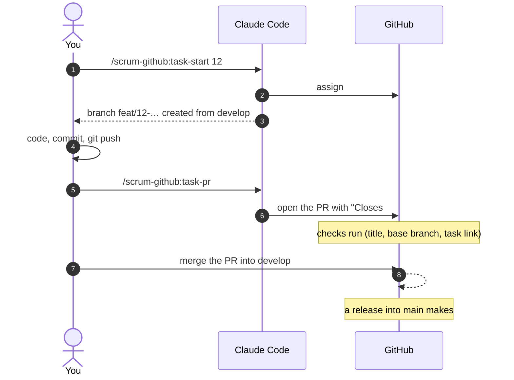

# Cheat sheet: Developer

The commands for one task, in order. Type them in Claude Code, at the root of the project's
repository. Every option: [the plugin's README](../plugins/scrum-github/README.md).
The words and the big picture, for you and your non-technical teammates: [Start here](start-here.md).

## In one minute

You never move a task by hand: starting it, opening its pull request and merging it move it for
you. With a `develop` branch (the default) a merged task waits In review until the release.

## One task

| Step | Command | Example |
|---|---|---|
| 1. See your work and what to do next | `/scrum-github:my-tasks` | `/scrum-github:my-tasks` |
| 2. Take the task: assigned to you, In progress, branch created from the latest working branch | `/scrum-github:task-start` | `/scrum-github:task-start 12` |
| 3. Write the code, commit, push the branch | (git as usual) | `git push -u origin feat/12-login` |
| 4. Bring in what the team merged meanwhile | `/scrum-github:sync` | `/scrum-github:sync` |
| 5. Write the PR description and open the PR into the working branch | `/scrum-github:task-pr` | `/scrum-github:task-pr` |
| 6. Merge the PR | (on GitHub) | `trunk`: the task moves to Done and closes. With `develop`: it stays In review with `on: develop` until the release |
| 7. Delete merged branches | `/scrum-github:cleanup` | `/scrum-github:cleanup` |

`my-tasks` lists your open tasks in every sprint and the backlog, what blocks them, their time
estimates and the time left in the open sprint, the pull requests waiting for your review, and
the task to do next (it offers to start it). `/scrum-github:my-tasks for an-nguyen` shows a
teammate's.

The PR description always has `Closes #12`. Without that line the `scrum-pr-link-check` check
fails; a PR that belongs to no task gets the label `no-task`.

## Branches

The repository's `branching.preset` decides where a task goes. In `standard` and `environments`
a task branch starts from `develop` and its pull request targets `develop`; the task reaches
`main` (and Done) with a release. Only a hotfix (`hotfix/N-slug`) starts from `main` and goes
back into it. In `trunk` everything starts from and goes into `main`.

| What | Command | Example |
|---|---|---|
| Merge the latest `develop` into your task branch (`main` into a hotfix branch) | `/scrum-github:sync` | `scrum sync` |
| What is on `develop` and not on `main`, drift, stale branches | `/scrum-github:branches` | `scrum branches` |
| Delete branches whose PR was merged, locally and on origin (asks first) | `/scrum-github:cleanup` | `scrum cleanup`, then `scrum cleanup --yes` |

`sync` refuses with uncommitted changes (commit or stash first) and on `develop` or `main`. On a
conflict it lists each file with who last changed it on `develop` and leaves the merge for you:
fix the files, `git add`, `git merge --continue`, or `git merge --abort` to go back.

Every PR is checked by `pr-check`: a [Conventional Commits](https://www.conventionalcommits.org)
title (`feat(auth): log in with email`, `fix: …`), the right base branch (a task branch into
`develop`, never into `main`), and `Closes #N`. It runs on GitHub when the PR is opened or
edited; `/scrum-github:task-pr` proposes a title and base that pass. Squash-merge task PRs; a
back-merge (`main` → `develop`) is merged with a merge commit.

## Hotfix (production cannot wait)

Presets `standard` and `environments`; in `trunk` a normal task already starts from `main`.

| Step | Command | Example |
|---|---|---|
| 1. Branch `hotfix/N-slug` from `main`, task In progress | `/scrum-github:hotfix` | `/scrum-github:hotfix 31` |
| 2. Fix, commit, then write the patch version into the version files | `scrum hotfix prepare` | `scrum hotfix prepare`, then `scrum hotfix prepare --yes` |
| 3. Open the PR into `main` (with the version marker) | `/scrum-github:task-pr` | `/scrum-github:task-pr` |
| 4. Merge it | (on GitHub) | The version is published, the task is Done, back-merge PRs open |

## Let AI agents work your tasks

| Step | Command | Example |
|---|---|---|
| See the plan only: tasks, waves, what is left out, time estimate | `/scrum-github:run --dry-run` | `/scrum-github:run --dry-run` |
| Run your New `ai-ready` tasks of the open sprint | `/scrum-github:run` | `/scrum-github:run` |
| Run only some tasks | `/scrum-github:run` | `/scrum-github:run 102,107` |
| At most K agents at once (default 3) | `/scrum-github:run --max-parallel K` | `/scrum-github:run --max-parallel 2` |
| One pull request per wave instead of one in total | `/scrum-github:run --pr-per-wave` | `/scrum-github:run --pr-per-wave` |

Each agent works one task in its own local git worktree and commits only locally. Tasks that do
not block each other run in the same wave; each wave is merged into an integration branch
(`run/{sprint}-{login}`) and tested before the next. At the end only that branch is pushed, as one
pull request to review: acceptance criteria as checkboxes, estimate against actual time, how to
test by hand, what to look at closely. The agents run code on your machine with your
permissions, so the command shows the plan and waits for your yes. If a run stops,
`/scrum-github:run` offers to continue it.

## If the repository has the In review status

| Your PR | The task |
|---|---|
| Draft | In progress |
| Ready for review | In review |
| Back to draft, or closed without merging | In progress |
| Merged | Done in `trunk`; with `develop`, In review with `on: develop` until the release reaches `main` |

## When you need it

| What | Command | Example |
|---|---|---|
| List or change tasks | `/scrum-github:task` | `/scrum-github:task my tasks in progress` |
| Add or change a time estimate | `/scrum-github:task` | `/scrum-github:task estimate #12: work 25m, review 20m` |
| Report a bug | `/scrum-github:task-new` | `/scrum-github:task-new bug: login fails on Safari` |
| What to do next | `/scrum-github:next` | `/scrum-github:next` |
| A command fails on login or network | `/scrum-github:doctor` | `/scrum-github:doctor` |

Do not edit `status:` or `points:` labels by hand; use `/scrum-github:task`.
