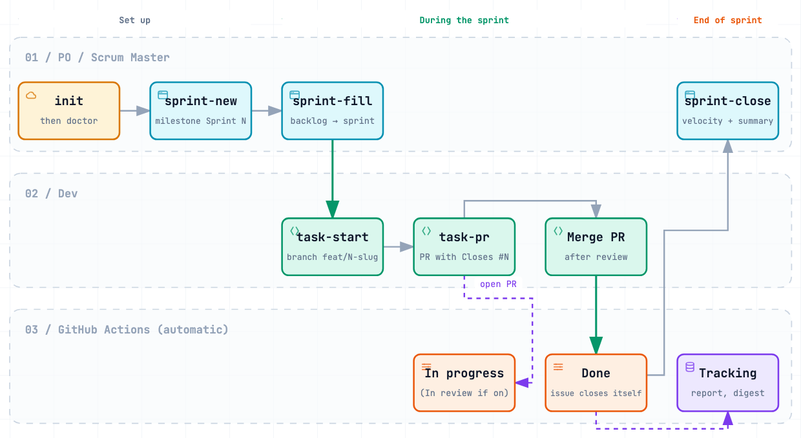
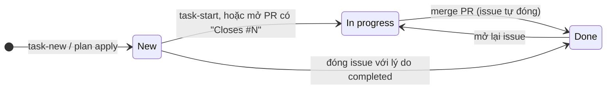
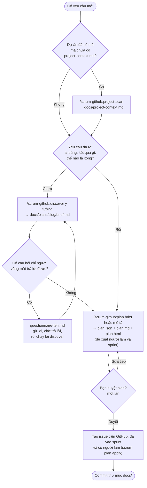
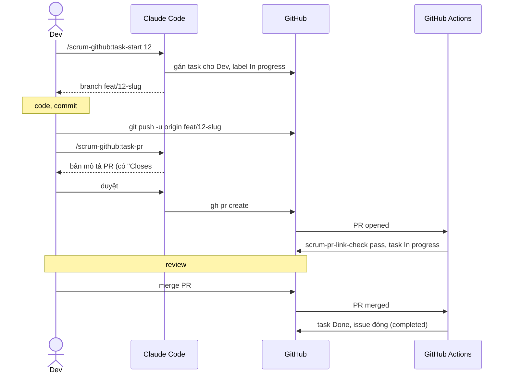

# Hướng dẫn áp dụng scrum-github

Tài liệu cho cả team: PO, Scrum Master và Dev. Mới dùng lần đầu thì đọc mục 1 → 4. Đã dùng rồi thì
tra [bảng lệnh](#2-bảng-lệnh) và [các flow](#5-các-flow-sử-dụng). Tra lệnh và cấu hình đầy đủ ở
[README của plugin](../plugins/scrum-github/README.md) (tiếng Anh).

**Mục lục**
1. [Plugin làm gì](#1-plugin-làm-gì)
2. [Bảng lệnh](#2-bảng-lệnh)
3. [Cài đặt (mỗi người một lần)](#3-cài-đặt-mỗi-người-một-lần)
4. [Thiết lập repo dự án (một người làm, một lần)](#4-thiết-lập-repo-dự-án-một-người-làm-một-lần)
5. [Các flow sử dụng](#5-các-flow-sử-dụng)
   - [Flow A: Mở sprint mới](#flow-a-mở-sprint-mới)
   - [Flow B: Từ yêu cầu tới task](#flow-b-từ-yêu-cầu-tới-task)
   - [Flow C: Dev làm một task](#flow-c-dev-làm-một-task)
   - [Flow D: Thêm task lẻ hoặc bug](#flow-d-thêm-task-lẻ-hoặc-bug)
   - [Flow E: Theo dõi tiến độ](#flow-e-theo-dõi-tiến-độ)
   - [Flow F: Đóng sprint](#flow-f-đóng-sprint)
6. [Quy ước team](#6-quy-ước-team)
7. [Board kanban (tuỳ chọn)](#7-board-kanban-tuỳ-chọn)
8. [Xử lý sự cố](#8-xử-lý-sự-cố)
9. [Giới hạn hiện tại](#9-giới-hạn-hiện-tại)
10. [Checklist áp dụng](#10-checklist-áp-dụng)

---

## 1. Plugin làm gì

Plugin chạy Scrum ngay trên GitHub. Nó không có cơ sở dữ liệu riêng: **mọi thứ là issue, label và
milestone của GitHub**, nên ai có quyền vào repo là thấy được tiến độ.



*Bản tương tác (phóng to, tìm kiếm, dò đường đi): mở [diagrams/sprint-flow.html](diagrams/sprint-flow.html)
trên máy. Nguồn: [diagrams/sprint-flow.workflow.json](diagrams/sprint-flow.workflow.json).*

| Scrum | Trên GitHub | Cần biết |
|---|---|---|
| Sprint | Milestone `Sprint {n}` | Ngày bắt đầu, kết thúc và velocity được ghi ẩn trong mô tả milestone |
| Task | Issue | Có đúng một label `status: …` và tối đa một label `points: N` |
| Trạng thái | Label `status: New`, `status: In progress`, `status: Done` | Tự đổi theo PR. Không sửa tay |
| Task xong | Issue **đóng với lý do "completed"** | Đóng với lý do "not planned" thì không tính điểm |
| Feature / Epic | Issue có label `type: feature` / `type: epic`; con của nó là sub-issue | Không tính điểm |
| Backlog | Issue **không có milestone** | Không vào báo cáo sprint cho tới khi được gán vào sprint |
| Plan | `docs/plans/<slug>/plan.json`, kèm bản xem `plan.md` | Bản chụp lúc lập plan. Sau khi tạo issue, GitHub mới giữ trạng thái thật |
| Velocity | Tổng điểm task Done trong sprint | Ghi lại khi đóng sprint |

Vòng đời một task:



---

## 2. Bảng lệnh

Trong Claude Code, mỗi lệnh gõ dạng `/scrum-github:<tên>`, có thể kèm mô tả bằng lời. Không dùng
Claude Code thì gọi script `scrum` (cột thứ ba). Trong Claude Code, `scrum` có sẵn trên PATH khi
plugin được cài cho user (`/plugin install` mặc định như vậy); cài cho riêng một project (scope
local) hoặc nạp bằng `--plugin-dir` thì không, khi đó các skill tự gọi bằng đường dẫn đầy đủ. Sau
khi thiết lập, repo dự án có sẵn script tại `.github/scrum/bin/scrum`.

| Lệnh Claude Code | Ai, khi nào | Script tương ứng | Ví dụ |
|---|---|---|---|
| `init` | SM, một lần cho mỗi repo; chạy lại sau khi sửa cấu hình hoặc nâng plugin | `scrum init [--dry-run] [--force-file PATH]` | `/scrum-github:init` |
| `doctor` | Bất kỳ ai, khi cài xong hoặc khi một lệnh báo lỗi | `scrum doctor [--json]` | `/scrum-github:doctor` |
| `next` | Bất kỳ ai, khi không biết làm gì tiếp | `scrum next [--json]` | `/scrum-github:next` |
| `sprint-new` | SM, đầu sprint | `scrum sprint new [--start DATE] [--length DAYS] [--goal TEXT]` | `/scrum-github:sprint-new bắt đầu thứ 2 tới, mục tiêu "Đăng ký, đăng nhập"` |
| `sprint-fill` | SM và team, buổi Sprint Planning | `scrum sprint fill [SPRINT] [--capacity N] [--add N,N] [--yes]` | `/scrum-github:sprint-fill sức chứa 20 điểm` |
| (không có) | SM, PO: xem team, lĩnh vực, capacity và tải trong sprint | `scrum team [--json]` | `scrum team` |
| `backlog` | PO, SM: xem việc chưa vào sprint | `scrum backlog` | `/scrum-github:backlog còn task nào chưa ước lượng?` |
| `project-scan` | Tech lead, một lần cho dự án có mã sẵn; làm mới khi mã đổi nhiều | `scrum context status` | `/scrum-github:project-scan` |
| `discover` | PO, khi yêu cầu còn mơ hồ | (không có) | `/scrum-github:discover cho người dùng bình luận dưới bài viết` |
| `plan` | PO, SM: biến yêu cầu thành task | `scrum plan check FILE`, `scrum plan apply FILE` | `/scrum-github:plan docs/plans/blog-comments/brief.md` |
| `task-new` | Bất kỳ ai: thêm một task hay bug (vào sprint đang mở, hoặc backlog khi chưa có sprint mở) | `scrum task new --title T [--points N] [--assignee LOGIN] [--sprint S \| --backlog] [--bug] [--work D] [--review D] [--by ai\|human]` | `/scrum-github:task-new bug: nút Lưu không phản hồi trên Safari, 2 điểm, giao cho an-nguyen` |
| `my-tasks` | Dev: xem hết việc của mình và nên làm gì tiếp | `scrum mine [--user LOGIN]` | `/scrum-github:my-tasks` |
| `task-start` | Dev: nhận task | `scrum task start N` | `/scrum-github:task-start 12` |
| `task` | Bất kỳ ai: xem, chuyển sprint, đổi điểm hoặc thời gian, giao, bỏ task | `scrum task list\|move\|estimate\|assign\|drop` | `/scrum-github:task đổi #12 thành 3 điểm`, `scrum task estimate 12 --review 30m` |
| `task-pr` | Dev: viết mô tả PR và mở PR | (dùng `gh pr create`) | `/scrum-github:task-pr` |
| `sprint-status` | Cả team, hằng ngày | `scrum status [SPRINT]` | `/scrum-github:sprint-status ai còn nhiều việc nhất?` |
| `sprint-report` | SM, review hoặc gửi stakeholder | `scrum report [SPRINT] [--out FILE]` | `/scrum-github:sprint-report` |
| `sprint-close` | SM, cuối sprint | `scrum sprint close [SPRINT] [--yes] [--create-next]` | `/scrum-github:sprint-close` |
| `project-setup` | SM, một lần: bật board kanban (tuỳ chọn) | `bash wizards/project-board.sh`, `scrum project init` | `/scrum-github:project-setup` |
| (không có) | SM, khi thôi dùng plugin trong repo | `scrum uninstall [--dry-run] [--yes]` | `scrum uninstall`, xem rồi thêm `--yes` |

Lệnh nào ghi lên GitHub thì đều cho xem trước và hỏi bạn trước khi ghi.

---

## 3. Cài đặt (mỗi người một lần)

**Bước 1. Cài công cụ.**

```bash
brew install gh jq yq
gh auth login -h github.com -s repo,workflow
```

**Bước 2. Kiểm tra.**

```bash
gh auth status          # Logged in to github.com
jq --version            # jq-1.6 trở lên
yq --version            # phải có chữ "mikefarah"
```

> Đừng dùng `pip install yq`: lệnh đó cài một công cụ khác trùng tên, và plugin sẽ từ chối nó.

**Bước 3. Cài plugin trong Claude Code** (không dùng Claude Code thì bỏ qua bước này):

```
/plugin marketplace add tuandtse243/tasks-manager
/plugin install scrum-github@tasks-manager
```

---

## 4. Thiết lập repo dự án (một người làm, một lần)

Thường là Scrum Master hoặc tech lead, làm trong một bản clone của repo dự án.

**Bước 1. Khởi tạo.** Mở Claude Code ở thư mục gốc của repo dự án:

```
/scrum-github:init
```

Lệnh cho xem trước rồi mới ghi. Kết quả:

| Tạo ra | Để làm gì |
|---|---|
| `.github/scrum.yml` | Cấu hình |
| Label status, points, `type: feature`, `type: epic`, `scrum: meta`, `no-task` | Label cũ không bao giờ bị xoá |
| `.github/ISSUE_TEMPLATE/task.yml` | Form tạo task trên GitHub, có ô Points |
| `.github/pull_request_template.md` | Có sẵn dòng `Closes #` và các mục Evidence, Merge Danger |
| Workflow `scrum-status-sync`, `scrum-pr-link-check`, `scrum-daily-digest` | Tự đổi trạng thái, kiểm tra PR có gắn task, gửi digest |
| `.github/scrum/` | Bản runtime mà workflow gọi tới, và `files.json` ghi lại các file `init` đã sinh. Không sửa tay |

**Bước 2. Sửa cấu hình** `.github/scrum.yml`. Khoá nào không ghi thì dùng giá trị mặc định. Cấu
hình gợi ý cho team ở Việt Nam:

```yaml
version: 1
timezone: Asia/Ho_Chi_Minh        # "hôm nay", burndown và digest tính theo giờ Việt Nam
language: vi                      # bảng tiến độ, digest, báo cáo HTML, tổng kết sprint bằng tiếng Việt
sprint:
  length_days: 12                 # ngày lịch, tính cả ngày đầu: thứ 2 tuần 1 tới thứ 6 tuần 2
  working_days: [1, 2, 3, 4, 5]   # ngày làm việc (1 = thứ 2); mặc định đã là thứ 2 tới thứ 6
points:
  scale: [1, 2, 3, 5, 8]          # Fibonacci; task lớn hơn 8 thì nên chia nhỏ
digest:
  cron: "0 1 * * 1-5"             # giờ UTC: 8 giờ sáng giờ Việt Nam, thứ 2 tới thứ 6
  webhook_format: slack           # gửi thêm digest ra chat: slack (cả Google Chat, Mattermost) hoặc telegram
attention:
  stale_days: 2                   # task In progress không có hoạt động quá 2 ngày làm việc thì "cần chú ý"
  behind_percent: 15              # sprint chậm hơn đường lý tưởng quá 15% phạm vi thì "cần chú ý"
planning:
  hours_per_point: 4              # tuỳ chọn: plan.md hiện thêm số giờ (1 điểm = 4 giờ)
  merge_minutes: 5                # phút merge và chạy test giữa hai đợt, dùng khi cộng thời gian (mặc định 5)
team:                             # tuỳ chọn: /plan gợi ý người làm theo danh sách này
  - login: tuandt
    areas: [backend]              # lĩnh vực thường làm
    capacity: 10                  # điểm mỗi sprint
    review_hours: 6               # tuỳ chọn: số giờ review mỗi sprint; sprint-fill cảnh báo khi vượt
  - login: an-nguyen
    areas: [frontend]
```

Không khai báo `team` thì danh sách team là những người có thể được giao issue trong repo (lấy từ
GitHub, không có lĩnh vực và capacity). Có `team` thì `task new`, `task assign` và `plan check` cảnh
báo khi giao cho login không có trong danh sách (vẫn giao). Xem tải từng người: `scrum team`.

Kiểm tra cấu hình mà không gọi mạng: `scrum config`. Sửa xong thì chạy lại `/scrum-github:init`:
lệnh đồng bộ label và tự cập nhật các file sinh ra theo cấu hình mới (Issue Form khi đổi
`points.scale`, workflow digest khi đổi `digest.cron`), rồi commit và push.

**Bước 3. Commit và push `.github/` lên nhánh mặc định.** Chưa push thì workflow chưa chạy.

```bash
git add .github && git commit -m "Set up scrum-github" && git push
```

**Bước 4. Bật branch protection** cho nhánh chính, bắt buộc check `scrum-pr-link-check` phải pass.
Như vậy không ai merge được PR không gắn task. Phần *Settings → Actions → Workflow permissions*
để mặc định.

**Bước 5. Kiểm tra cả bộ** bằng `/scrum-github:doctor`: công cụ, đăng nhập, cấu hình, label, workflow
đã lên nhánh mặc định chưa. Mỗi lỗi kèm cách sửa. Sau đó `/scrum-github:next` cho biết việc kế tiếp.

Chạy lại `init` lúc nào cũng an toàn: file không đổi báo `unchanged`; file bạn chưa sửa mà cũ so
với cấu hình hoặc plugin báo `updated` và được cập nhật; file bạn đã sửa tay báo `conflict` và được
giữ nguyên. Muốn lấy bản mới cho file đó thì dùng `--force-file <path>`.

**Nâng từ 0.4 trở về trước:** lệnh `scrum-init` nay là `/scrum-github:init` (tên cũ bị bỏ từ 0.6.0).
Lần chạy đầu sau khi nâng, repo chưa có bản ghi file nên mọi file khác bản mới đều báo `conflict`;
từ lần sau thì file chưa sửa tự cập nhật.

**(Tuỳ chọn) Trạng thái In review.** Muốn thấy task nào đang chờ review, thêm vào `.github/scrum.yml`:

```yaml
statuses:
  in_review: In review
```

rồi chạy lại `/scrum-github:init` (tạo label `status: In review`, cập nhật workflow), commit và push.
Từ đó PR nháp giữ task ở In progress, PR sẵn sàng review đưa task sang In review, PR chuyển về nháp
hoặc đóng không merge đưa task về In progress, merge thì Done. Bảng tiến độ, digest và báo cáo có
thêm cột In review; mục "Cần chú ý" nêu task chờ review quá `attention.review_days` ngày làm việc.
Bật giữa sprint thì task đang có chỉ đổi ở sự kiện PR kế tiếp. Có dùng board thì thêm cột
`In Review` (một lựa chọn mới của trường Status, đặt giữa In Progress và Done) rồi chạy
`scrum project init`; thiếu cột này lệnh sẽ dừng và báo. Bỏ khoá này là tắt; label cũ được giữ.
Luồng này đã được chạy thử trên repo và board thật: PR nháp, sẵn sàng review, về nháp, đóng không
merge, mở lại và merge đều đổi đúng cả label lẫn cột trên board.

Repo thiết lập từ trước 0.5.0 khi chạy lại `init` sẽ thấy các workflow có bản mẫu mới bị báo
`conflict`, dù không ai sửa: phiên bản cũ chưa ghi lại file nào do `init` viết. So với bản mẫu,
file nào không tự sửa thì thêm `--force-file <đường dẫn>` để lấy bản mới.

**Gỡ khỏi repo:** `scrum uninstall` cho xem những gì sẽ xoá và giữ; thêm `--yes` để xoá. Lệnh giữ
`.github/scrum.yml`, file bạn đã sửa, và mọi thứ trên GitHub (label, milestone, issue).

---

## 5. Các flow sử dụng

| Thời điểm | Ai | Flow |
|---|---|---|
| Đầu sprint | SM | [A. Mở sprint mới](#flow-a-mở-sprint-mới) |
| Đầu sprint, hoặc khi có yêu cầu mới | PO, SM | [B. Từ yêu cầu tới task](#flow-b-từ-yêu-cầu-tới-task) |
| Hằng ngày | Dev | [C. Dev làm một task](#flow-c-dev-làm-một-task) |
| Bất kỳ lúc nào | Cả team | [D. Thêm task lẻ hoặc bug](#flow-d-thêm-task-lẻ-hoặc-bug) |
| Hằng ngày | Cả team | [E. Theo dõi tiến độ](#flow-e-theo-dõi-tiến-độ) |
| Cuối sprint | SM | [F. Đóng sprint](#flow-f-đóng-sprint) |

### Flow A: Mở sprint mới

```
/scrum-github:sprint-new bắt đầu thứ 2 tới, mục tiêu "Đăng ký, đăng nhập"
```

Hoặc dùng CLI:

```bash
scrum sprint new --start 2026-11-23 --goal "Đăng ký, đăng nhập"
```

- Tên tự tăng theo mẫu `Sprint {n}`; độ dài lấy từ `sprint.length_days` nếu không ghi `--length`.
- Ngày tương đối ("thứ 2 tới") được Claude đổi thành ngày cụ thể.
- Lệnh cảnh báo nếu ngày trùng một sprint đang mở.

Nếu backlog đã có task, lệnh nhắc bước kế tiếp là chọn task cho sprint:

```
/scrum-github:sprint-fill
```

- Sức chứa mặc định là velocity trung bình của tối đa ba sprint đã đóng gần nhất; chưa có sprint
  nào đóng thì Claude hỏi một con số (`--capacity N`).
- Claude đề xuất các task vừa sức chứa, task chặn đứng trước task bị chặn; bạn sửa danh sách, xem
  trước các cảnh báo (vượt sức chứa, task chưa có điểm, bị chặn bởi task ngoài sprint, người vượt
  `review_hours`), rồi mới đồng ý để chuyển task vào sprint.
- Khi task có ước lượng thời gian, lệnh in tổng phút review của từng người trong sprint (và sau khi
  thêm), so với `review_hours` của họ. Cảnh báo không chặn việc thêm task.
- Xem riêng backlog: `/scrum-github:backlog`.

Tiếp theo: [Flow B](#flow-b-từ-yêu-cầu-tới-task) hoặc [Flow D](#flow-d-thêm-task-lẻ-hoặc-bug).

### Flow B: Từ yêu cầu tới task

Bạn chỉ cần nhớ `/scrum-github:plan`. Khi yêu cầu còn mơ hồ, nó đề nghị chạy `discover` trước; khi
dự án có mã mà chưa có tài liệu bối cảnh, nó đề nghị `project-scan`.



**Không lệnh nào ghi lên GitHub trước khi bạn duyệt plan.** Các file trong `docs/` thì bạn tự commit.

#### B1. Quét dự án: `/scrum-github:project-scan`

Chỉ cần cho dự án đã có mã. Lệnh đọc mã rồi viết `docs/project-context.md`: công nghệ, cấu trúc,
luồng chính, mô hình dữ liệu, quy ước, cách chạy và test, bảng thuật ngữ. Mỗi nhận định ghi rõ file
làm căn cứ; điều mã không nói thì ghi "chưa rõ".

- Lần sau chỉ đọc lại các thư mục đã đổi. `--full` để quét lại toàn bộ.
- Mục "Team notes" do team viết và không bao giờ bị ghi đè.
- Xem tài liệu cũ tới đâu: `scrum context status`.

#### B2. Làm rõ yêu cầu: `/scrum-github:discover <ý tưởng>`

Dùng khi ý tưởng còn mơ hồ, ví dụ:

```
/scrum-github:discover cho người dùng bình luận dưới bài viết
/scrum-github:discover docs/yeu-cau/thanh-toan.md --deep
```

Diễn biến một phiên:
1. Claude tự tìm sự thật (đọc mã, tìm trên web) và **chỉ hỏi bạn các quyết định**.
2. Câu hỏi đi theo từng vòng, có đánh số, câu nào cũng kèm câu trả lời đề xuất. Trả lời "yes" là
   đồng ý hết đề xuất; hoặc trả lời theo số, ví dụ `2: chỉ người đã đăng nhập`.
3. Lệnh hỏi tới khi đủ tám nhóm: người dùng và vai trò, luồng chính, dữ liệu, trường hợp biên, yêu
   cầu phi chức năng, tích hợp, ràng buộc, phần ngoài phạm vi.
4. Dự án có mã: lệnh kết luận yêu cầu *phù hợp*, *phù hợp nếu có thay đổi*, hay *xung đột*. Khi xung
   đột, bạn chọn phương án trước khi đi tiếp.
5. Lệnh giữ thuật ngữ khớp với bảng thuật ngữ của dự án: một từ dùng theo nghĩa khác sẽ thành câu hỏi.
6. Bạn xác nhận bản tóm tắt, lệnh ghi `docs/plans/<slug>/brief.md`.

**Câu hỏi cho người vắng mặt.** Khi một quyết định thuộc về người không có trong phiên (PO, khách
hàng), lệnh đề nghị viết `questionnaire-<người>.md` cạnh brief. Brief khi đó ở trạng thái
`Status: draft` với mục "Open questions". Gửi file cho người đó, họ ghi câu trả lời ngay dưới từng câu
hỏi; rồi chạy lại `discover` trên cùng thư mục để hoàn tất brief.

Ba mức: `--quick` (tối đa một vòng hỏi, không dùng agent), mặc định, và `--deep` (thêm nghiên cứu web
và một lượt soát brief độc lập).

#### B3. Lập plan: `/scrum-github:plan <brief hoặc mô tả>`

```
/scrum-github:plan docs/plans/blog-comments/brief.md
/scrum-github:plan thêm nút xuất CSV ở trang báo cáo, admin dùng, xong khi tải được file đúng cột --quick
```

Diễn biến:
1. Chia yêu cầu thành task theo **lát cắt dọc**: mỗi task tự cho ra một hành vi kiểm tra được, không
   phải một tầng kỹ thuật đứng riêng. Mỗi task có tiêu chí nghiệm thu, điểm trong thang, ước lượng
   thời gian (phút làm, phút người review và test tay, AI hay người làm), subtask (thành checklist
   trong issue) và phụ thuộc.
2. Một agent soát bản nháp: thiếu việc, ngoài phạm vi, task quá lớn, phụ thuộc sai, tiêu chí không
   kiểm tra được. `--quick` bỏ bước này.
3. Lệnh đề xuất người làm cho task chưa có người (theo `team.areas` và tải hiện tại, chỉ chọn người
   trong team, giữ nguyên người bạn đã nêu) và sprint (task vừa capacity của sprint đang mở, theo thứ
   tự phụ thuộc, vào sprint; phần dư để backlog kèm lý do).
4. Bạn xem **một lần**, trong chat và trong trang `plan.html` cạnh `plan.md`: bảng task có người làm
   và sprint, tải từng người, capacity của sprint, các phát hiện và danh sách việc sẽ làm trên GitHub.
   Sửa bằng lời ("gộp T3 với T4", "T6 vào Sprint 5", "T3 cho @minh-ho") tới khi duyệt; trang được
   sinh lại và mục "Thay đổi" cho thấy phần đã đổi.
5. Sau khi bạn duyệt, lệnh tạo epic, feature, task trên GitHub, đã có milestone và người làm, nối
   sub-issue và phụ thuộc, rồi ghi số issue vào `plan.json`. Không cần chạy `sprint-fill` hay giao
   task sau đó.

**Trang `plan.html`.** Do `plan check`, `plan render`, `plan apply` sinh ra, mở được khi không có mạng,
theo chế độ sáng hoặc tối của máy. Trang gồm tóm tắt, thay đổi so với lần xem trước, sơ đồ phụ thuộc
theo đợt (rê chuột để xem chuỗi phụ thuộc), dòng thời gian vẽ đúng tỉ lệ (khi task có ước lượng thời
gian), tải và capacity, chi tiết từng task, góp ý của plan-critic,
những gì sẽ tạo trên GitHub, giả định và ngoài phạm vi. Trang chỉ để xem; bạn trả lời trong chat.
`plan.html` và `.plan-snapshot.json` không cần commit (`plan init` ghi sẵn `.gitignore` trong thư mục plan).

Plan có bản nháp còn câu hỏi mở thì chỉ lập tiếp khi bạn đồng ý biến mỗi câu hỏi thành một giả định.

**Vào sprint hay vào backlog.** Lệnh đề xuất sprint cho từng task như trên. Task không ghi `sprint` thì vào **backlog** (không milestone,
không vào báo cáo sprint). Ghi `"sprint": "current"` để vào sprint đang mở, hoặc tên sprint cụ thể;
từng task có thể ghi riêng. Đưa task từ backlog vào sprint: gán milestone trên GitHub, hoặc sửa
`sprint` trong plan rồi chạy `scrum plan apply <file> --update`.

**Ước lượng.** `plan.md` hiện tổng điểm từng feature và cả plan, số task chưa có điểm, số giờ (nếu có
`hours_per_point`), và số sprint ước tính theo velocity trung bình của tối đa ba sprint đã đóng gần nhất.

**Ước lượng thời gian.** Điểm đo độ phức tạp; thời gian cho biết bao giờ xong. Mỗi task có thể có
`estimate`: `work_minutes` (thời gian làm), `review_minutes` (người review và test tay, thường là nút
cổ chai khi AI làm) và `by` (`ai` hoặc `human`). Plugin lưu trong một khối ở cuối thân issue
("AI ~25m · Review ~20m"), không dùng label. `plan.md` và `plan.html` cộng thời gian **theo đợt**: các
task cùng đợt chạy song song nên mỗi đợt mất bằng task lâu nhất, cộng `planning.merge_minutes` (mặc
định 5) để merge và chạy test; thời gian review là tổng. Ví dụ ba đợt (20m, 8m), (15m, 35m), (20m)
xong phần làm sau 20 + 5 + 35 + 5 + 20 + 5 = 90 phút. Task chưa có ước lượng được nêu riêng.

**Chạy lại an toàn.** `scrum plan apply` ghi số issue vào `plan.json` ngay sau mỗi issue được tạo:

| Tình huống | Lệnh | Kết quả |
|---|---|---|
| Xem trước | `scrum plan apply <file> --dry-run` | In ra những gì sẽ tạo, nối, bỏ qua; không ghi gì |
| Lần trước lỗi giữa chừng | `scrum plan apply <file>` | Chỉ tạo phần chưa có số issue |
| Vừa thêm task vào plan | `scrum plan apply <file>` | Chỉ tạo task mới và nối chúng |
| Sửa tiêu đề, nội dung, điểm, thời gian, sprint | `scrum plan apply <file> --update` | Cập nhật issue còn mở; không đụng label trạng thái, người được giao, issue đã đóng |
| Sửa tiếp plan cũ bằng Claude | `/scrum-github:plan docs/plans/<slug>/` | Giữ nguyên id và số issue đã có |

> **Đừng xoá số `issue` hay đổi `id` trong plan**: lần tạo sau sẽ sinh issue trùng.

### Flow C: Dev làm một task



**Bước 1. Nhận task.**

```
/scrum-github:task-start 12
```

Lệnh gán task cho bạn (nếu chưa ai nhận), đổi sang In progress và tạo branch `feat/12-<slug>` từ nhánh
mặc định. Đang có thay đổi chưa commit thì git từ chối đổi branch, và trên GitHub không có gì thay đổi.

**Bước 2. Code, commit, push.** Push branch lên trước khi mở PR:

```bash
git push -u origin feat/12-<slug>
```

**Bước 3. Mở PR.**

```
/scrum-github:task-pr
```

- Lệnh lấy số task từ tên branch (`feat/12-…` là task 12), đọc diff và tiêu chí nghiệm thu của task.
- Nó viết mô tả gồm tóm tắt thay đổi, **Evidence** (lệnh/test đã chạy và kết quả, tiêu chí nào đã được
  chứng minh), **Merge Danger** (rủi ro khi merge), và mục **Task** với dòng `Closes #12`.
- Bạn duyệt hoặc yêu cầu sửa; chỉ sau khi duyệt lệnh mới chạy `gh pr create`. PR đã mở rồi thì lệnh
  thay mô tả bằng `gh pr edit`.

Viết PR bằng tay cũng được, miễn mô tả có **`Closes #12`** (PR template đã có sẵn dòng này).

**Bước 4. Review rồi merge.** Điều gì xảy ra tự động:

| Bạn làm | Task |
|---|---|
| Mở PR có `Closes #12` | New → In progress (trạng thái khác giữ nguyên) |
| Merge PR | Done, issue tự đóng. Merge vào nhánh nào cũng vậy |
| Đóng PR mà không merge | Giữ nguyên |
| Một PR làm nhiều task | Viết mỗi task một dòng: `Closes #12`, `Closes #13` |
| PR không gắn task (sửa CI, nâng thư viện) | Gắn label `no-task`, nếu không check `scrum-pr-link-check` báo đỏ |

### Flow D: Thêm task lẻ hoặc bug

Cho một vài task rời. Nhiều task từ cùng một tính năng thì dùng [Flow B](#flow-b-từ-yêu-cầu-tới-task).

```
/scrum-github:task-new Thêm nút "Quên mật khẩu", 3 điểm, giao cho an-nguyen
/scrum-github:task-new bug: nút Lưu không phản hồi trên Safari, 2 điểm
```

Hoặc dùng CLI:

```bash
scrum task new --title "Quên mật khẩu" --points 3 --assignee an-nguyen
scrum task new --title "Nút Lưu không phản hồi trên Safari" --points 2 --bug
scrum task new --title "Viết tài liệu API" --sprint "Sprint 4"
scrum task new --title "Sửa lỗi đăng nhập" --points 1 --work 15m --review 10m
scrum task estimate 12 --review 30m          # chỉ đổi thời gian review, giữ điểm và thời gian làm
```

- Task vào sprint đang mở, trạng thái New. `--sprint` để chọn sprint khác.
- Thời gian viết dạng `90`, `25m`, `2h` hoặc `1h30m`. `--by human` khi task cần người làm; mặc định `ai`.
- Claude không tự đặt điểm hay người nhận nếu bạn không nói. Nhờ nó ước lượng thì nó đề xuất điểm
  kèm lý do; nhờ nó viết mô tả thì nó cho bạn xem trước khi tạo.
- Tạo trên giao diện GitHub cũng được (New issue → mẫu Task): ô Points tự thành label `points: N`,
  nhưng bạn **phải tự gán milestone**.

### Flow E: Theo dõi tiến độ

| Muốn biết | Lệnh | Kết quả |
|---|---|---|
| Ai đang làm gì, còn bao nhiêu điểm | `/scrum-github:sprint-status` hoặc `scrum status` | Bảng theo người và trạng thái, % điểm đã xong, task chưa có điểm, số ngày làm việc còn lại, và mục "Cần chú ý" (task bị chặn, task In progress không động, task thiếu người nhận hoặc điểm, sprint chậm). Khi task có ước lượng thời gian, bảng có thêm phút làm và phút review còn lại theo người, và số task chưa có ước lượng thời gian |
| Việc của tôi còn mất bao lâu | `/scrum-github:my-tasks` hoặc `scrum mine` | Thời gian từng task, ước tính phần việc còn lại trong sprint đang mở theo đợt, và phút review |
| Hỏi một câu cụ thể | `/scrum-github:sprint-status An đang làm gì?` | Claude trả lời từ bảng |
| Tin tóm tắt mỗi sáng | Tự động | Workflow comment vào issue `Sprint N digest` theo `digest.cron`, kèm mục "Cần chú ý". Muốn nhận cả trên Slack, Google Chat, Mattermost hay Telegram: đặt secret `SCRUM_DIGEST_WEBHOOK` của repo (Telegram: `https://api.telegram.org/bot<TOKEN>/sendMessage?chat_id=<CHAT_ID>`, kèm `digest.webhook_format: telegram`) |
| Burndown và velocity để gửi stakeholder | `/scrum-github:sprint-report` hoặc `scrum report --out sprint-3.html` | File HTML mở được khi không có mạng, burndown dựng lại từ lịch sử task (task thêm, bỏ hay đổi điểm giữa sprint được tính đúng ngày) kèm đường phạm vi. Mặc định ghi vào `scrum-reports/<sprint>.html` |

### Flow F: Đóng sprint

**Bước 1. (Tuỳ chọn) Xuất báo cáo cuối sprint** trước khi đóng: `/scrum-github:sprint-report`.

**Bước 2. Đóng sprint.**

```
/scrum-github:sprint-close
```

Lệnh **chỉ hiện kế hoạch** trước: velocity, các task Done, các task sẽ chuyển sang sprint sau, và
sprint kế tiếp (tạo mới nếu chưa có). Khi bạn xác nhận, plugin:
- ghi velocity vào milestone,
- tạo sprint kế tiếp nếu chưa có,
- chuyển các task còn mở sang sprint mới, kèm comment trên từng task,
- đóng milestone,
- đăng bản tổng kết (mục tiêu, velocity so với các sprint trước, phạm vi thay đổi, task xong, task
  chuyển tiếp) thành comment trên issue `Sprint N digest`, để cả team đọc ở buổi review.

Bằng CLI: `scrum sprint close` để xem kế hoạch, rồi `scrum sprint close --yes --create-next` để thực hiện.

Velocity của các sprint trước giúp quyết định nhận bao nhiêu điểm cho sprint sau, và giúp `plan` ước
lượng số sprint.

---

## 6. Quy ước team

Nên thống nhất ở buổi kick-off.

1. **Mỗi PR đóng ít nhất một task**, hoặc có label `no-task`.
2. **Viết `Closes #n`, không viết `Solve #n`.** GitHub chỉ hiểu `close/closes/closed`,
   `fix/fixes/fixed`, `resolve/resolves/resolved`. Check của PR sẽ báo lỗi nếu thấy `Solve`.
3. **Không sửa label bằng tay.** Trạng thái đi theo PR. Đổi điểm, đổi sprint, giao người hay bỏ
   task thì dùng `/scrum-github:task` (ví dụ `/scrum-github:task đưa #12 về backlog`): label luôn
   đúng một giá trị và board được cập nhật cùng lúc.
4. **Task không làm nữa thì bỏ bằng `/scrum-github:task bỏ #12`** (đóng với lý do "not planned"),
   để không bị tính vào velocity.
5. **Mọi task trong sprint đều có điểm**, kể cả bug. Task không có điểm vẫn hiện trong báo cáo nhưng
   không vào burndown.
6. **Task cần nhiều hơn mức điểm lớn nhất thì chia nhỏ.**
7. **Hạn chế đổi điểm giữa sprint.** Burndown ghi nhận đúng ngày đổi điểm, nhưng ước lượng hay đổi làm
   velocity khó so sánh giữa các sprint. Khi cần đổi thì dùng `/scrum-github:task`.

---

## 7. Board kanban (tuỳ chọn)

Dùng một board GitHub Projects để xem task thành thẻ và kéo thả. Label `status: …` vẫn là nguồn sự
thật; board chỉ là bản sao được phép kéo thả. Nhờ vậy báo cáo, velocity và tự động hoá theo PR vẫn
chạy như cũ.

### 7.1 Board hoạt động thế nào

| Bạn làm | Kết quả |
|---|---|
| Mở hoặc merge PR, `task-start`, đóng hoặc mở lại issue | Thẻ chuyển cột ngay trong lần chạy workflow |
| Kéo thẻ trên board | Label đổi ở lần đồng bộ định kỳ kế tiếp (mặc định 15 phút). Muốn ngay: *Actions → `scrum-project-sync` → Run workflow* |
| Kéo thẻ sang Done | Label Done, issue **đóng với lý do completed**, được tính vào velocity |
| Kéo thẻ ra khỏi Done | Issue mở lại, label theo cột mới |
| Kéo thẻ, và PR cũng đổi trạng thái trước lần đồng bộ | Label thắng: thẻ quay về, issue có comment giải thích. Riêng cột Done thì board thắng khi *Auto-close issue* đang bật |
| Kéo vào cột không có trong cấu hình (ví dụ "Review") | Không đổi gì, lần đồng bộ in cảnh báo |
| Gắn label `points: N` | Field Points trên board tự cập nhật. Sửa Points trên board sẽ bị ghi đè |

Cột mặc định `Todo` / `In Progress` / `Done` ứng với `New` / `In progress` / `Done`. Muốn đặt tên cột
khác thì sửa `project.status_options`.

### 7.2 Bật board (Scrum Master làm một lần)

**Cách nhanh:**

```
/scrum-github:project-setup
```

Claude đưa bạn một lệnh wizard để chạy **trong terminal của bạn** (không chạy qua `!` của Claude Code,
vì wizard cần bạn gõ và cách đó lưu secret rỗng):

```bash
bash <đường-dẫn-plugin>/wizards/project-board.sh
```

Wizard mở từng trang cần làm, nói rõ bấm gì, nhận token mà không hiện ra màn hình, đặt secret, và ghi
khối `project:` vào `.github/scrum.yml` sau khi hỏi. Xong wizard, quay lại Claude Code; Claude kiểm
tra cấu hình, cài workflow đồng bộ, chạy thử `scrum project init --dry-run` và chỉ chạy thật khi bạn đồng ý.

**Cách làm tay:** các bước wizard làm hộ (tạo Project, tắt các automation tự đổi cột, tạo token và
secret `SCRUM_PROJECT_TOKEN`, thêm khối `project:`, `scrum init`, `scrum project init`) được ghi đầy đủ,
kèm loại token và quyền cần cấp, ở [README của plugin → Project board](../plugins/scrum-github/README.md#turn-it-on).
Gợi ý cho team ở Việt Nam: đặt `project.poll_cron: "*/15 1-11 * * 1-5"` (khoảng 8h–19h, thứ 2–6) để
tiết kiệm phút Actions.

**Sau cả hai cách:** **ẩn field *Synced status*** trong mọi view (sửa tay sẽ làm đồng bộ sai), rồi
commit và push `.github/`.

**Tắt board:** đặt `project.enabled: false` và xoá `.github/workflows/scrum-project-sync.yml`. Label
không bị ảnh hưởng.

### 7.3 Lưu ý

- Từ board về label **không tức thời**, vì GitHub Actions không nhận được sự kiện kéo thẻ.
- Token hết hạn thì workflow `scrum-project-sync` báo đỏ và GitHub gửi email. Thay secret là chạy lại
  được. Các workflow chính (PR → label) vẫn chạy bình thường.
- Issue được mở lại khi đang có label `status: New` thì giữ New. Nhờ vậy kéo thẻ từ Done về Todo cho
  kết quả đúng.

---

## 8. Xử lý sự cố

Chạy `/scrum-github:doctor` trước: lệnh kiểm tra một lượt công cụ, đăng nhập và scope của `gh`,
cấu hình, label, workflow trên nhánh mặc định, phiên bản runtime và secret của board, rồi nêu cách
sửa từng lỗi. Bảng dưới cho những trường hợp `doctor` không thấy được.

| Triệu chứng | Nguyên nhân | Cách xử lý |
|---|---|---|
| Merge PR mà task không đóng | PR viết `Solve #n` thay vì `Closes #n` | Sửa mô tả PR thành `Closes #n` |
| Merge PR vào một nhánh khác mà task không đóng | Nhánh đích chưa có `.github/` (workflow chạy theo file trên nhánh đích của PR) | Đưa `.github/` vào nhánh đó, hoặc đóng task tay với lý do completed |
| Check `scrum-pr-link-check` đỏ | Mô tả PR không có `Closes #n` | Thêm dòng đó, hoặc gắn label `no-task` |
| `task-pr` báo cần push | Branch chưa có trên remote | `git push -u origin <branch>` rồi chạy lại |
| `scrum: command not found` trong Claude Code, hoặc `scrum --version` không in phiên bản plugin | Plugin cài ở scope local thì `bin/` không lên PATH, hoặc một lệnh `scrum` khác đứng trước | Skill tự dùng đường dẫn đầy đủ nên vẫn chạy. Muốn gõ `scrum` thì cài plugin ở scope user, hoặc dùng `bash "${CLAUDE_PLUGIN_ROOT}/runtime/bin/scrum"` |
| `points 5 not in the scale` | Giá trị không có trong `points.scale` | Dùng giá trị trong thang, hoặc sửa cấu hình |
| Đổi giờ digest mà không có tác dụng | Giờ chạy được ghi cứng vào file workflow | Chạy lại `/scrum-github:init`, rồi commit và push. Nếu file báo `conflict` vì bạn đã sửa tay, thêm `--force-file .github/workflows/scrum-daily-digest.yml` |
| Task có hai label status | Ai đó sửa label bằng tay | Lần đổi trạng thái kế tiếp tự chuẩn hoá. Muốn sửa ngay thì gỡ label thừa |
| `init` báo `conflict` | Bạn đã sửa tay file đó, hoặc repo cài từ trước 0.5.0 nên chưa có bản ghi | Giữ bản của bạn, hoặc `--force-file <path>` để lấy bản mới; từ đó file tự cập nhật |
| Xung đột merge ở `.github/scrum/files.json` | Hai người chạy `init` trên hai nhánh | Giữ một bên, merge xong chạy lại `/scrum-github:init` để ghi lại cho đúng |
| `plan apply` báo `no sprint named "…"` hoặc `… is closed` | Plan ghi tên sprint không tồn tại hoặc đã đóng | Sửa `sprint` trong plan. Chưa có gì được tạo |
| `plan apply` dừng giữa chừng | Lỗi mạng hoặc GitHub | Chạy lại đúng lệnh đó: chỉ phần chưa có số issue được tạo |
| Issue có checklist hoặc mục "Blocked by" trong nội dung | Repo không cho dùng sub-issue hoặc quan hệ phụ thuộc | Không cần làm gì; quan hệ được ghi ngay trong nội dung issue |
| `plan`/`discover` báo tài liệu bối cảnh đã cũ | Có nhiều commit sau lần quét trước | Chạy `/scrum-github:project-scan` (chỉ đọc lại thư mục đã đổi) |
| Secret `SCRUM_PROJECT_TOKEN` rỗng | Đặt secret qua `!` của Claude Code | Đặt lại qua trang Settings hoặc terminal riêng |

---

## 9. Giới hạn hiện tại

- Không hỗ trợ GitHub Enterprise Server. Trên Windows chỉ chạy qua WSL.
- Kéo thẻ trên board chỉ đến label ở lần đồng bộ định kỳ kế tiếp.
- Burndown đọc lịch sử của tối đa 100 task trong sprint và 30 task có thể đã rời sprint; quá giới hạn
  thì phần còn lại dùng trạng thái hiện tại và báo cáo ghi rõ điều đó.
- "Cần chú ý" đọc quan hệ "bị chặn bởi" cho tối đa 50 task chưa xong; backlog cũng vậy.
- Không có ngày nghỉ lễ: chỉ các thứ trong `sprint.working_days` được coi là ngày làm việc.
- Bật In review giữa sprint không đổi task đang có; chúng chỉ đổi ở sự kiện PR kế tiếp.
- `scrum` chỉ có sẵn trên PATH của Claude Code khi plugin cài ở scope user (quan sát ở Claude Code
  2.1.328); skill vẫn chạy với mọi cách cài.

---

## 10. Checklist áp dụng

**Chuẩn bị**
- [ ] Mọi thành viên đã cài `gh` (đã login), `jq`, `yq` bản mikefarah
- [ ] Người dùng Claude Code đã cài plugin

**Thiết lập repo**
- [ ] Chạy `/scrum-github:init`, xem kỹ phần xem trước
- [ ] Sửa `.github/scrum.yml`: timezone, `length_days`, thang điểm, giờ digest
- [ ] Commit và push `.github/` lên nhánh mặc định
- [ ] Bật branch protection, bắt buộc check `scrum-pr-link-check`
- [ ] `/scrum-github:doctor` không còn lỗi
- [ ] (Tuỳ chọn) `project-setup` để bật board

**Thống nhất với team**
- [ ] Đọc mục 6 cùng team, chốt thang điểm và độ dài sprint
- [ ] Ai tạo sprint, ai đóng sprint
- [ ] Ai duyệt plan do AI đề xuất
- [ ] Dùng `planning.hours_per_point` hay chỉ dùng điểm

**Sprint đầu tiên**
- [ ] Dự án có mã sẵn: chạy `project-scan`, commit `docs/project-context.md`
- [ ] `sprint-new`, rồi `sprint-fill` nếu backlog có task, hoặc `plan` (chạy `discover` trước nếu yêu cầu còn mơ hồ) hay `task-new`
- [ ] Mỗi dev thử `task-start`, rồi `task-pr` cho một PR `Closes #n`
- [ ] Sáng hôm sau kiểm tra issue digest
- [ ] Cuối sprint chạy `sprint-report` và `sprint-close`, lấy velocity làm mốc cho sprint sau
