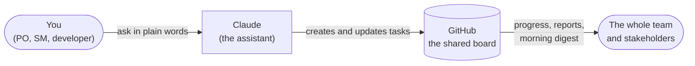
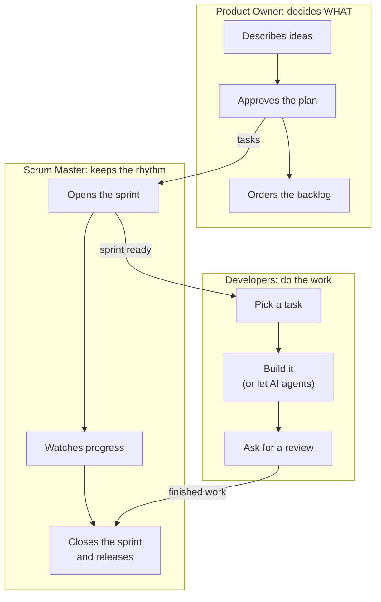
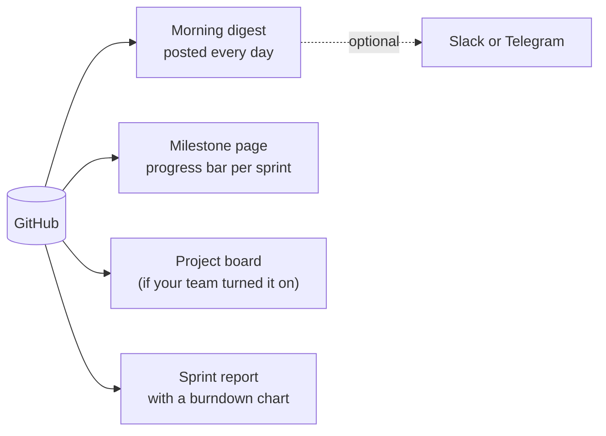

# Start here: scrum-github in plain words

This page is for everyone on the team, **including people who do not write code**: Product
Owners, Scrum Masters, managers and anyone who wants to follow the work. It needs no technical
knowledge. When you want the details, the [cheat sheets](#where-to-go-next) and the
[adoption guide](adoption-guide.md) have them.

**On this page**
1. [What it is, in one minute](#1-what-it-is-in-one-minute)
2. [The words you will hear](#2-the-words-you-will-hear)
3. [The journey of one task](#3-the-journey-of-one-task)
4. [One sprint, step by step](#4-one-sprint-step-by-step)
5. [From an idea to tasks](#5-from-an-idea-to-tasks)
6. [Who does what](#6-who-does-what)
7. [How you talk to it](#7-how-you-talk-to-it)
8. [Follow the work without typing anything](#8-follow-the-work-without-typing-anything)
9. [Common questions](#9-common-questions)

---

## 1. What it is, in one minute

Think of a **whiteboard with sticky notes**: one note per piece of work, in columns from "to do"
to "done". scrum-github puts that whiteboard **inside GitHub**, the website where the team's code
already lives, so you need no separate tool such as Jira or Trello.

Two things make it different from a whiteboard:

- **The notes move by themselves.** When a developer starts a task or finishes it, the note
  changes column on its own. Nobody has to remember to update it.
- **You have an assistant.** You ask Claude in normal sentences: *"what is left in this
  sprint?"*, *"add a task: the Save button does nothing on Safari"*. It does the GitHub work for
  you, and **always shows you what it will do and asks before changing anything**.



---

## 2. The words you will hear

| Word | What it means | What GitHub calls it |
|---|---|---|
| **Sprint** | A short, fixed period (often one or two weeks) in which the team finishes a chosen set of work | A *milestone* named `Sprint 1`, `Sprint 2`, … |
| **Task** | One piece of work, small enough to finish within a sprint | An *issue* |
| **Bug** | A task that fixes something broken | An issue with the label `bug` |
| **Status** | Where a task is: New, In progress, In review, Done | A label such as `status: In progress` |
| **Points** | How big or tricky a task is (not hours): 1 is small, 7 is large | A label such as `points: 3` |
| **Backlog** | Work that is wanted but not yet planned into a sprint | Issues with no milestone |
| **Velocity** | How many points the team finished in a sprint; it helps plan the next one | Saved when a sprint is closed |
| **Pull request** (PR) | A developer saying "here is my finished work, please check it" | A *pull request* |
| **Release** | Sending the finished work to users as a new version, such as `v1.4.0` | A *release* and a *tag* |
| **Repository** (repo) | The project's folder on GitHub: code, tasks, everything | A *repository* |
| **Command** | A short instruction to Claude that starts with `/`, such as `/scrum-github:next` | – |

---

## 3. The journey of one task


| Column | What is happening | Who makes it move |
|---|---|---|
| **New** | The task exists and waits for someone | The Product Owner adds it, or a plan creates it |
| **In progress** | Someone is working on it | A developer (or an AI agent) starts it |
| **In review** | The work is finished and being checked | The developer asks for a review; the work then waits for the next release |
| **Done** | Users have it | The release that ships it |

> **Why is my task "In review" and not "Done"?** In most set-ups a task is only Done when users
> can actually use it, which is when a **release** goes out. Until then it shows a small label
> such as `on: develop` meaning *"finished, waiting to be released"*. That is normal.

---

## 4. One sprint, step by step


| Step | What happens | What to type (in Claude Code) | Usually done by |
|---|---|---|---|
| **1. Plan** | Create the sprint and choose the tasks that fit | `/scrum-github:sprint-new` then `/scrum-github:sprint-fill` | Scrum Master, with the team |
| **2. Build** | Developers and AI agents do the tasks | `/scrum-github:my-tasks`, `/scrum-github:task-start 12` | Developers |
| **3. Follow** | Look at progress and at what needs attention | `/scrum-github:sprint-status` | Everyone |
| **4. Close** | See what got done; unfinished work moves to the next sprint | `/scrum-github:sprint-close` | Scrum Master |
| **5. Release** | Publish a new version for users | `/scrum-github:release` | Scrum Master or tech lead |

---

## 5. From an idea to tasks

You do not have to write tasks one by one. Describe what you want, and Claude helps you turn it
into a clear list of tasks.


1. **Say what you want**, in your own words:
   `/scrum-github:discover let users comment under a post`
2. **Answer a few questions.** Claude asks about what is unclear (*"who can delete a comment?"*)
   and suggests answers you can just accept. The result is a short written summary, the *brief*.
3. **Get a plan:** `/scrum-github:plan` splits the brief into features and tasks, sizes them,
   suggests who does what and in which sprint, and opens a page to look at (`plan.html`, with a
   timeline and each person's load). Say what to change, or approve.
4. **Only after you approve** are the tasks created on GitHub, already assigned and in a sprint.

---

## 6. Who does what



| You are | Your cheat sheet |
|---|---|
| Product Owner | [PO cheat sheet](cheat-sheet-po.md) |
| Scrum Master | [SM cheat sheet](cheat-sheet-sm.md) |
| Developer | [Dev cheat sheet](cheat-sheet-dev.md) |
| Manager or stakeholder | Section 8 below: you do not need to type anything |

---

## 7. How you talk to it

You type in **Claude Code** (the chat window your team has installed), in the project's folder.
A command is the `/scrum-github:` part followed by a name; after it, write your request in normal
words. Example:

```
You:     /scrum-github:task-new bug: the Save button does nothing on Safari, 3 points

Claude:  I will create this task:
           Title:   the Save button does nothing on Safari
           Type:    bug · 3 points · Sprint 4
         Shall I go ahead?

You:     yes

Claude:  Created #41 in Sprint 4 (status New).
```

(The exact wording Claude uses may differ.)

**You cannot break anything by asking.** Every command that changes something on GitHub shows
you first what it will do and waits for your yes.

### The five commands worth remembering

| When you want to… | Type |
|---|---|
| Know what to do next | `/scrum-github:next` |
| See how the sprint is going | `/scrum-github:sprint-status` |
| Add a task or a bug | `/scrum-github:task-new` followed by a description |
| Turn an idea into tasks | `/scrum-github:discover` followed by the idea, then `/scrum-github:plan` |
| Get a report to share | `/scrum-github:sprint-report` |

Something does not work? Type `/scrum-github:doctor`: it checks the set-up and says in plain words
what to fix.

---

## 8. Follow the work without typing anything



- **The morning digest.** Every morning a short summary is posted on the GitHub issue called
  `Sprint N digest`: what moved, what is left, and a **"Needs attention"** list (blocked tasks,
  tasks nobody has touched, a sprint falling behind). Your team can also have it sent to Slack or
  Telegram.
- **The milestone page.** On GitHub, open *Issues → Milestones*: each sprint shows a progress bar.
- **The project board** (optional): a classic column board that updates itself.
- **The sprint report**: a web page with a *burndown chart* (a line showing the work left going
  down day by day). Ask your Scrum Master, who creates it with `/scrum-github:sprint-report`.

---

## 9. Common questions

**Do I need to know how to code?**
No. Product Owners and Scrum Masters only type commands and normal sentences. Developers use a
few more commands for their code.

**What are points, and why not hours?**
Points compare size: a 3 is about three times a 1. They are easier to agree on than hours and
make planning steadier. If you also want time, a task can carry an estimate such as *"work 25
minutes, review 20 minutes"*.

**What does "Needs attention" mean?**
A short list of what may need a person: a blocked task, a task with no owner or no points, work
that has not moved for a while, or a sprint behind schedule.

**What are AI agents here?**
Tasks marked `ai-ready` can be done by AI working in parallel. A developer starts them, and the
result comes back as one piece of work for a person to check. Nothing goes out without a review.

**Can I just edit the labels on GitHub myself?**
Better not: the statuses and points are kept in step automatically. Ask Claude instead, for
example `/scrum-github:task move #12 to the backlog`.

**A command says something about login or network.**
Run `/scrum-github:doctor`. It lists what is wrong and how to fix it, one line each.

---

## Where to go next

| You want to… | Read |
|---|---|
| Use it as a Product Owner | [PO cheat sheet](cheat-sheet-po.md) |
| Use it as a Scrum Master | [SM cheat sheet](cheat-sheet-sm.md) |
| Use it as a developer | [Dev cheat sheet](cheat-sheet-dev.md) |
| Set up a repository, see every flow in detail | [Adoption guide](adoption-guide.md) |
| Look up every command and setting | [Plugin README](../plugins/scrum-github/README.md) |
